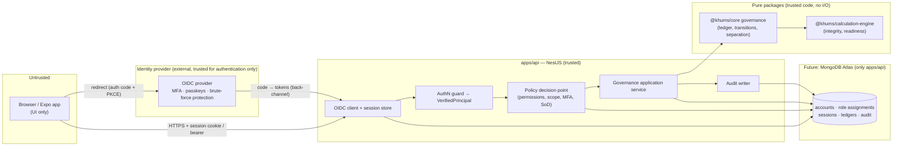
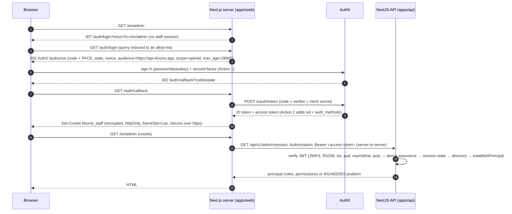
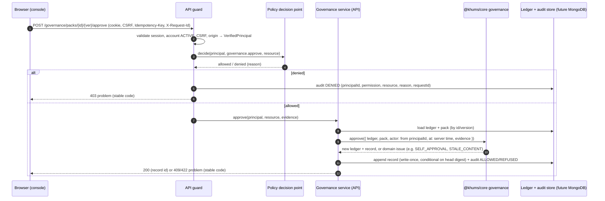

# Authentication and Authorization Architecture (M4.6)

> **Status (2026-11-20):** **M4.6.0** (this architecture, first reported as M4.5.1) is complete.
> **M4.6.1** (the centralized authorization engine, §5.5–§5.6) is complete. It includes the
> permission catalogue, the trusted-principal registry, the pure evaluator and the authorized
> governance entry point in `@khums/core`. The four additional governance policies were approved
> by the owner on 2026-11-20.
>
> **2026-11-21 (M4.6.2b):** staff sign-in has moved from Auth0 to NestJS username/password
> (§4.10, **implemented, awaiting review**). The Auth0 staff path (web SDK, API token verification,
> development identities file) has been removed. The Auth0 sections below remain the historical
> record of M4.6.2; Auth0 stays reserved for future public Google Sign-In.
>
> **M4.6.2** (trusted identity integration with Auth0, §4.5–§4.8) is **partially complete**.
> Staff sign-in in Next.js, Auth0 access-token verification in the API and principal
> establishment from verified identities are implemented and tested. **Not production-ready:**
> there is no authoritative role or session store until M4.6.3 (production refuses every staff
> request), the MFA evidence path must be confirmed on the real tenant, and the
> `VERIFIED_PRINCIPAL` ledger actor is not implemented. FR-2 stays open. This document supports
> FR-2 (`docs/research/RULE_PACK_STRUCTURE.md` §9) and builds on the governance domain (§5.9,
> ARCHITECTURE §5c), which stays authoritative.

## 1. Scope and principles

**Scope:** identities and permissions for **rule-pack governance staff**:

- administrators;
- authors;
- researchers;
- scholar reviewers;
- independent approvers;
- auditors.

End-user accounts (optional cloud sync, Milestone 6) use the same API and pattern but a separate
user population. They are covered only where the design must stay compatible.

**Principles:**

1. **The server establishes identity.** The browser never supplies an actor id, role, approval
   status, publication status or activation eligibility. The API derives all of them from a
   verified provider token or session and from server-side records.
2. **Authentication is delegated** to a standards-based OIDC identity provider. The platform
   never stores passwords.
3. **Authorization is centralized and permission-based.** One policy decision point maps
   principal + permission + resource to a decision. There are no scattered role-name checks.
4. **The governance domain stays authoritative.** Authorization decides whether a person _may
   attempt_ an action. `@khums/core` governance then decides whether the action is _valid_
   (separation of duties, digests, transitions). Both must pass.
5. **Administrators cannot bypass religious approval.** No role or "break-glass" path can create
   review, approval or publication records for someone else, or skip a domain rule.
6. **Fail closed.** Missing, expired or ambiguous identity data means deny.

## 2. Trust boundaries



| Boundary                 | Trusted for                                                                                | Never trusted for                                                                |
| ------------------------ | ------------------------------------------------------------------------------------------ | -------------------------------------------------------------------------------- |
| Browser / Expo client    | Displaying data; collecting user input                                                     | Identity, roles, approval, publication or activation status, digests, timestamps |
| Identity provider        | Verifying who signs in (`iss`, `sub`, `auth_time`, `amr`, `acr`), MFA, credential recovery | Roles or permissions (kept server-side), governance decisions                    |
| NestJS API               | Session handling, permission decisions, timestamps, request ids, persistence, audit        | Bypassing domain rules                                                           |
| Governance domain (core) | Transitions, separation of duties, integrity binding, ledger verification                  | Authentication (it receives verified principals)                                 |
| Calculation engine       | Integrity recomputation, readiness gates                                                   | Identity or authorization (no auth code in shared packages)                      |
| MongoDB (future)         | Durable storage of accounts, roles, sessions, ledgers and audit                            | Being the only immutability control (FR-3 needs write-once rules or anchoring)   |

## 3. Identity model

The types are declared in `@khums/shared-types/auth` (types only, no runtime code):

- **`VerifiedPrincipal`:**
  - `principalId`: the platform's stable, opaque id, never an email;
  - verified external identity: provider `issuer` + `subject`, plus `emailVerified`;
  - `accountStatus`: `INVITED → ACTIVE ⇄ SUSPENDED → DEACTIVATED`, stored server-side;
  - active `RoleAssignment`s, each with a scope (all, or specific Marja ids) and an append-only
    grant/revoke history;
  - effective permissions, computed on the server;
  - `authentication`: `authenticatedAt` (`auth_time`), methods (`amr`), and an assurance level
    (AAL1–3, NIST SP 800-63B);
  - `session`: an opaque id, plus issue, idle-expiry and absolute-expiry times.
- **Account lifecycle:** invitation only, so there is no public sign-up for staff. Suspension
  takes effect immediately. Deactivation is permanent but keeps the history for audit.
- **Revocation** covers sessions (single or all for a user), role assignments and accounts. Every
  request re-checks the account status and the session record on the server, so revocation does
  not wait for a token to expire.
- **Audit attribution:** every governance record and audit entry names `principalId`, never a
  display name or email.

**Link to the ledger (M4.6.4a, decision D3).** The governance API writes every ledger actor as
`{ kind: 'STAFF_PRINCIPAL', subject }`, where `subject` is the `principalId` of the principal the
staff guard established from the session. No request can supply or influence it (request
contracts are strict and carry no actor). Records written before M4.6.4a keep
`{ kind: 'UNVERIFIED_REFERENCE', subject }`; both kinds stay valid, nothing is rewritten or
re-hashed, and separation rules compare `subject` across kinds. The authorization attestation
(decision id, permission, request id) is recorded in the audit event of every command, not in the
ledger record.

## 4. Authentication strategy

### 4.1 Options compared

Prices are **indicative** and come from public pages and third-party summaries that disagree in
places. Confirm them on the vendors' official pricing pages before any decision. Governance
needs only **tens of staff accounts**, so per-user cost is small. The deciding factors are
security features, operational load and data residency.

| Option                                         | Security fit for governance staff                                                                                                           | Operational load                                        | Indicative cost at ~10–50 staff                                                                                                                               | Main trade-offs                                                                                        |
| ---------------------------------------------- | ------------------------------------------------------------------------------------------------------------------------------------------- | ------------------------------------------------------- | ------------------------------------------------------------------------------------------------------------------------------------------------------------- | ------------------------------------------------------------------------------------------------------ |
| **Auth0 (Okta)** — managed                     | Strong: OIDC, passkeys/WebAuthn, MFA policies, step-up (`acr_values`, `max_age`), breached-password detection, rate limiting, log streaming | Low                                                     | MFA and role features need a paid plan; entry B2C plans start from tens of USD per month[^auth0]                                                              | Pricing changes over time; advanced MFA tiers can be costly; US-based processor                        |
| **Microsoft Entra ID / External ID** — managed | Strong: Conditional Access, phishing-resistant MFA (FIDO2/passkeys), sign-in risk; mature audit logs                                        | Low–medium (Azure tenant)                               | External ID free up to 50,000 MAU; premium features and SMS are paid add-ons[^entra]; staff could also be workforce accounts if an organization tenant exists | Configuration complexity; best value if the organization already uses Microsoft 365                    |
| **Amazon Cognito (Essentials/Plus)** — managed | Good: OIDC, TOTP/WebAuthn, threat protection in Plus                                                                                        | Medium (AWS, more DIY UI)                               | Essentials ≈ USD 0.015/MAU after 10,000 free; Plus ≈ USD 0.02/MAU with no free tier[^cognito]                                                                 | Cheapest at scale; weaker step-up ergonomics; more custom work                                         |
| **Clerk** — managed                            | Good for app users; passkeys and MFA                                                                                                        | Low                                                     | Free tier and low paid tiers reported by third parties[^clerk]                                                                                                | Optimized for front-end SDK patterns (tokens in the browser); fits the server-session design less well |
| **Keycloak** — self-hosted                     | Strong features (OIDC, WebAuthn, step-up flows)                                                                                             | **High**: patching, HA, backups, key rotation, upgrades | License free; infrastructure plus about 0.5–1 FTE of operations reported[^keycloak]                                                                           | Full control and data residency, but the platform becomes an identity operator                         |
| Build our own                                  | Not acceptable                                                                                                                              | Very high                                               | n/a                                                                                                                                                           | Password storage, MFA, recovery and brute-force protection are specialist areas; **rejected**          |

### 4.2 Recommendation (for owner decision)

- **Use a managed OIDC provider. Do not self-host or build authentication.**
- **Shortlist Microsoft Entra (External ID, or workforce accounts if an organization tenant
  exists) and Auth0.** Choose by:
  1. support for **phishing-resistant MFA enforced per role** (passkeys or security keys) and
     **step-up** through `acr_values` / `max_age` with `acr` / `amr` claims;
  2. **data residency** and processing terms acceptable for staff data;
  3. audit-log export;
  4. cost at the plan level that includes items 1–3.
- **Keycloak** remains the fallback if data residency or vendor independence becomes a hard
  requirement and an operator is budgeted.
- **The design is provider-neutral.** The API depends only on standard OIDC (discovery, JWKS,
  `iss`/`aud`/`exp`/`nonce`/`auth_time`/`amr`/`acr` validation), so switching providers changes
  configuration, not the domain.

### 4.3 Sessions, tokens and cookies

- **Web (governance console and web app):**
  - The **API itself is the confidential OIDC client**, using Authorization Code + PKCE with
    `state` and `nonce`. That keeps a single backend, with no separate BFF.
  - Provider tokens stay on the server. The browser only receives an **opaque session cookie**:
    `__Host-` prefix, `HttpOnly`, `Secure`, `SameSite=Strict` for the governance console, `Path=/`,
    and no `Domain`.
- **Session lifetimes:**
  - Governance sessions have a **15-minute idle timeout and an 8-hour absolute limit**.
  - Sessions are stored server-side (MongoDB later) and can be revoked.
  - The session id is rotated at sign-in, after step-up and after any role change.
  - Raw session ids are never logged; only a keyed hash is.
- **Tokens:**
  - Access tokens are short-lived (5–15 minutes) and used only server-side.
  - Refresh tokens are rotated with reuse detection, and only if the provider's session must be
    extended.
  - A user's sessions are revoked on password change, MFA reset, suspension and role revocation.
- **CSRF:**
  - `SameSite=Strict` cookies;
  - an `Origin`/`Sec-Fetch-Site` check on every unsafe method;
  - a synchronizer CSRF token for state-changing governance requests;
  - JSON-only bodies, with existing CORS allow-listing (`CORS_ORIGINS`).
- **Expo mobile (future end users only; there is no governance on mobile):**
  - Authorization Code + PKCE in the system browser;
  - tokens kept in the OS secure store;
  - the API validates bearer access tokens (`aud` = API, JWKS signature, expiry).
  - Mobile never performs governance actions.
- **Password recovery and MFA reset** are handled by the provider. An MFA reset for reviewers,
  approvers and admins needs identity re-verification by a second administrator and revokes all
  of that user's sessions.
- **Rate limiting and brute force:**
  - the provider's attack protection (lockout, breached passwords, bot detection);
  - API-level rate limits per IP and per principal on authentication callbacks and governance
    routes;
  - exponential back-off on repeated denials.

### 4.4 Authentication flows

**Sign-in (web, server-side session):**

```mermaid
sequenceDiagram
  autonumber
  participant B as Browser
  participant API as NestJS API
  participant IdP as OIDC provider
  B->>API: GET /auth/login
  API->>API: create state, nonce, PKCE verifier (server-side, short-lived)
  API-->>B: 302 to IdP /authorize (code, PKCE, state, nonce, acr_values)
  B->>IdP: authenticate (passkey / MFA)
  IdP-->>B: 302 /auth/callback?code&state
  B->>API: GET /auth/callback (code, state)
  API->>IdP: POST /token (code + verifier, client auth)
  IdP-->>API: ID token + access token
  API->>API: validate iss, aud, exp, nonce, signature (JWKS), auth_time, amr/acr
  API->>API: load account by (iss, sub); require ACTIVE; build VerifiedPrincipal
  API->>API: create server session; rotate id
  API-->>B: Set-Cookie __Host-session (HttpOnly, Secure, SameSite=Strict)
```

**Step-up before a sensitive action (M4.6.0 design; superseded 2026-11-21: staff authenticate once, no step-up):**

```mermaid
sequenceDiagram
  autonumber
  participant B as Browser
  participant API as NestJS API
  participant IdP as OIDC provider
  B->>API: POST governance action (cookie + CSRF token)
  API->>API: policy: permission ok, but auth_time older than 10 min or assurance < AAL3
  API-->>B: 401 problem STEP_UP_REQUIRED
  B->>API: GET /auth/step-up?return=…
  API-->>B: 302 to IdP (prompt=login, max_age=0, acr_values=phishing-resistant)
  B->>IdP: re-authenticate with passkey / security key
  IdP-->>API: (callback as above) fresh auth_time, amr includes hwk/phr
  API->>API: update session assurance and auth_time; rotate session id
  B->>API: retry action
```

### 4.5 Implemented sign-in flow (M4.6.2, Auth0)

The owner chose **Auth0** and the official **Next.js SDK** (`@auth0/nextjs-auth0` 4.33.0) for staff
sign-in. This changes one M4.6.0 assumption (§4.3): the **Next.js server**, not the API, is the
confidential OIDC client and holds the sign-in session (ARCHITECTURE decision 34). The API stays
the only backend and the only place where identity becomes a trusted principal.



**Next.js (`apps/web/src/server/staff-auth*.ts`, `src/proxy.ts`):**

- Only `GET /auth/login`, `/auth/callback` and `/auth/logout` reach the SDK. Every other SDK
  route (profile, access-token, MFA, passkey, passwordless, back-channel logout, `/me/*`) is 404.
- `/auth/login` keeps only a same-origin admin `returnTo`. The SDK otherwise forwards every query
  parameter to Auth0, so `screen_hint=signup`, `audience`, `scope` or `connection` could be
  injected. `/auth/logout` drops browser parameters and returns to `{APP_BASE_URL}/`.
- Scope `openid` only (no profile or email; no `offline_access`, so **no refresh token**). The
  session cookie keeps only `sub`. `/auth/access-token` is disabled.
- Session: stateless, encrypted cookie; 15-minute inactivity, 8-hour absolute limit; `__Host-`
  prefix and `Secure` whenever the app is served over https. SameSite is **Lax** instead of
  Strict, because Strict cookies are not sent on the redirect back from Auth0. CSRF exposure is
  limited: the cookie authorizes nothing at the API (bearer tokens only) and there are no
  state-changing staff forms yet.
- Admin pages are rendered per request; the proxy redirects anonymous visitors, and the page
  checks the session again. Neither makes authorization decisions: the page shows only what the
  API returns. Public pages never call the SDK, so they set no cookies and work without any
  Auth0 configuration.

**API (`apps/api/src/auth/`):** see §4.6 (tokens), §4.7 (assurance) and §4.8 (sessions and
roles). Staff routes use `@StaffAuthenticated()` per controller; there is no global guard, so
public routes stay anonymous. The only staff endpoint is `GET /api/v1/admin/session`.

### 4.6 Access-token verification

`createAccessTokenVerifier` (jose 6.2.15) accepts a token only when all of these hold:

- compact JWS whose header is `alg: RS256` (HS256, RS384, `none` and `crit` headers refused);
- signature valid for a key from `https://{AUTH0_DOMAIN}/.well-known/jwks.json`. Keys are cached
  for at most 10 minutes; an unknown `kid` triggers a refetch at most every 30 seconds (forged
  `kid`s cannot amplify requests); fetches time out after 5 seconds;
- `iss` exactly `https://{AUTH0_DOMAIN}/`, and `aud` contains exactly `https://api.khums.app`. An
  **ID token is refused** because its `aud` is the client id;
- `exp` in the future, `nbf` (if present) in the past, `iat` present, not in the future and not
  older than `AUTH_ACCESS_TOKEN_MAX_AGE_SECONDS` (default 900), with 5 seconds of clock tolerance;
- `azp` in `AUTH0_STAFF_CLIENT_IDS`; machine-to-machine tokens (`gty: client-credentials`,
  `sub` ending in `@clients`) refused;
- well-formed `sub` and the Khums authentication-context claims (§4.7).

Nothing is read from a token before verification succeeds. JWKS failures (network, timeout, HTTP
error, invalid key set) and missing configuration return **503 `AUTHENTICATION_UNAVAILABLE`**;
every other failure returns **401 `INVALID_ACCESS_TOKEN`** with one fixed message (the reason is
logged as a code, never with the token). Identity or role headers, cookies, query parameters and
bodies are ignored.

### 4.7 MFA assurance evidence

Auth0 access tokens carry no `amr`, `acr` or `auth_time`, and Actions cannot set those names.
Two **post-login Actions** (`docs/auth0/actions/`) provide the evidence:

1. **Require MFA:** for the Khums application, every interactive sign-in calls
   `api.authentication.challengeWithAny` (security key, device biometrics, OTP), or
   `enrollWithAny` if no such factor is enrolled. Using `challengeWithAny` makes Auth0 record
   which factor was used.
2. **Authentication context:** for the Khums API audience, copies Auth0's own record into
   signed, namespaced claims: `https://khums.app/sid` (`event.session.id`) and
   `https://khums.app/auth_methods` (`[{ name, type?, at }]` from
   `event.authentication.methods`). No user or app metadata is used.

The API derives the evidence itself (`deriveAuthenticationContext`):

| Recorded step                                                  | Method                   | Credit               |
| -------------------------------------------------------------- | ------------------------ | -------------------- |
| `pwd` / `federated`                                            | `PASSWORD` / `FEDERATED` | first factor         |
| `passkey` (first factor)                                       | `PASSKEY`                | first factor; AAL2   |
| `mfa` + `otp`                                                  | `TOTP`                   | AAL2                 |
| `mfa` + `webauthn-roaming`                                     | `SECURITY_KEY`           | AAL3                 |
| `mfa` + `webauthn-platform`                                    | `PASSKEY`                | AAL2 (may be synced) |
| `mfa` without a type; SMS, email, push, recovery code, unknown | —                        | none                 |

- No recognised first factor, or steps dated after the token, refuses the token.
- **Only the current login counts** (security review, 2026-11-20). Auth0's `methods` lists
  everything completed during its session, which can span several logins. A second factor earns
  credit only if completed at or after the latest first factor, and a first-factor passkey only if
  it is that latest first factor. A password-only login never inherits earlier MFA, even if the
  MFA Action were disabled.
- **No AAL3 from labels (real-tenant review, 2026-11-20).** `webauthn-roaming` means only
  "enrolled as a security key". A cross-device (hybrid) passkey on a phone, which may be synced,
  can be enrolled the same way. Device biometrics (`webauthn-platform`) are AAL2 for the same
  reason. AAL3 is credited only when an `AuthenticatorAttestationSource` confirms verified
  evidence for the authenticator. **None exists today**, so every staff sign-in is at most AAL2.
  Since the 2026-11-21 policy no permission requires AAL3, so this affects only the reported
  assurance, not what staff may do.
- **Evidence needed for AAL3** (kept for a possible future policy; NIST SP 800-63B: phishing-resistant, hardware-protected,
  non-exportable key; synced passkeys are capped at AAL2), all bound to the credential used in
  this sign-in:
  1. the WebAuthn **attestation statement** verified at registration, chaining to a trusted root;
  2. an **AAGUID allow-list** of certified hardware keys, checked against the FIDO Metadata
     Service (certification level, no known compromise);
  3. **backup-eligible (BE) = 0** for the credential (device-bound, not synced);
  4. **user verification (UV) = 1** in the authentication assertion;
  5. a binding from that credential to this login (credential id in the signed evidence).
     Auth0 Action events expose none of these (only `{ name, timestamp }` plus, for
     `challengeWith*`, a factor `type`). Options: an Auth0 capability that surfaces verified
     attestation (to be confirmed with Auth0), or a Khums-run WebAuthn step-up ceremony in the API
     with its own attestation and MDS checks (a future milestone; needs persistence for credentials).
- **Evidence display:** `GET /api/v1/admin/session` returns `authentication.evidence`: every step
  received in the signature-verified token (`name`, `type` or null, time), whether it belongs to
  the current login, and the credit given. The staff console shows it, so real-tenant evidence
  can be confirmed without anyone handling tokens.
- `authenticatedAt` is the time of the latest first factor (informational and checked not to be
  in the future; it no longer gates any permission).
- **Authenticate once (owner policy, 2026-11-21).** Every permission requires AAL2 (a verified
  second factor at sign-in) and nothing more: no step-up, no AAL3, no repeated identity
  confirmation. A sign-in without verified MFA evidence (AAL1) is denied every permission with
  401 `MFA_REQUIRED` and an RFC 9470 `insufficient_user_authentication` challenge
  (`StaffAuthorizationService`). The `STEP_UP_REQUIRED` deny reason, the step-up window and the
  console's step-up button were removed. Session expiry (15 min idle, 8 h absolute, 15 min token
  age), revocation, suspension, roles, Marja scope and separation of duties are unchanged.
- **Fail closed:** if the Actions are not deployed, the claims are missing and every staff token
  is refused. If Auth0 does not record the factor `type` (Auth0 documents it only for
  `challengeWith*`), MFA earns no credit and every permission is denied. **This must be
  confirmed on the real tenant** (the admin page shows the derived assurance).

### 4.8 Sessions, revocation and role assignment

- **Session binding:** the principal's session id is the Auth0 session id (`sid` claim). Session
  window: issued at `iat`; idle expiry `min(exp, iat + max token age, absolute)`; absolute expiry
  8 hours after the last first-factor sign-in (older logins: 401 `REAUTHENTICATION_REQUIRED`).
- **Revocation source:** a `SessionStatusSource` port is consulted before every principal is
  established. A revoked session gets 401 `SESSION_REVOKED`.
- **Roles and account status:** only from a `StaffDirectory` port keyed by verified `iss` + `sub`.
  Role-like claims in tokens are ignored; nobody receives a role automatically. Unknown identity:
  403 `PRINCIPAL_NOT_ASSIGNED`. Account not `ACTIVE`: 403 `ACCOUNT_NOT_ACTIVE`.
- **Implementations today:**
  - **Development/test only:** `AUTH_DEV_IDENTITIES_FILE`, a JSON file listing subjects, principal
    ids, account status, roles and revoked session ids, read once at startup. The environment
    schema refuses it in production, and store selection ignores it in production.
  - **Production:** no authoritative store exists, so session state cannot be confirmed and every
    staff request gets 503. There is deliberately no fallback. Durable stores arrive in M4.6.3.
- **What logout does:** it deletes the Next.js session cookie and ends the Auth0 session
  (RP-initiated logout). It does **not** invalidate an access token already issued. That token
  stays usable at the API until it expires, at most `AUTH_ACCESS_TOKEN_MAX_AGE_SECONDS`
  (15 minutes by default), unless the session store marks the session revoked. **There is no
  immediate global session revocation** until a durable session store and back-channel logout
  exist (back-channel logout needs a stateful session store in the SDK).
- **Suspension and role revocation:** take effect on the next request, because every request
  re-reads the directory and establishes a fresh principal. The 60-second principal maximum age
  and every M4.6.1 check are unchanged.

### 4.9 Supervised enrolment of privileged staff

Design (M4.6.2). Enrolment proves who someone is; it grants nothing. Roles are assigned
separately, server-side, with the existing dual-control rules.

1. **Request:** a platform administrator (A1) records the request: the person, the intended
   roles and the reason.
2. **Account creation:** A1 creates the Auth0 user in the dashboard. Public sign-up is disabled.
   The user receives a password-set (invitation) email and cannot sign in yet: the MFA Action
   denies any user without an allowed factor.
3. **Identity verification:** a second administrator (A2), not A1 and not the person, verifies
   the person independently: a live video call matching government ID to the invitation
   address, or an in-person check. A2 records who verified, how and when.
4. **Supervised enrolment window:** during that call A2 sets the user's `app_metadata`
   `khums_mfa_enrollment` = `{ approved_until: <now + ≤ 2 h>, approved_by: "<A2>" }`. Only tenant
   administrators can edit `app_metadata`. The person signs in and enrolls a hardware security
   key (OTP as fallback) while A2 watches. A2 then removes `khums_mfa_enrollment`. The Action
   refuses windows longer than 2 hours.
5. **Role grant:** only after enrolment, roles are granted server-side. Today that is the
   development file; from M4.6.3/M4.6.4 it is the durable store with `PROPOSE`/`CONFIRM` dual
   control (policy 3). Enrolment never activates a role.
6. **Recovery:** a lost factor means an administrator resets MFA in Auth0. The account is then
   unenrolled and denied until steps 3–4 are repeated. Staff sessions should be revoked at the
   same time (needs the durable session store).

Unenrolled accounts cannot complete a sign-in, so they never reach a principal. Records from
steps 1, 3 and 4 belong in the governance audit log once it is durable (M4.6.3); until then they
are an operational procedure.

### 4.10 Staff username/password authentication (M4.6.2b)

> **Status: implemented (M4.6.2b, 2026-11-21), awaiting review.** It replaces Auth0 for **staff**
> sign-in (§4.5–§4.8 stay on record as the M4.6.2 design; superseded for staff). As-built details
> and the remaining work are in "Implementation (M4.6.2b)" at the end of this section. Auth0/Google Sign-In stays in the architecture as the **future option for public users**.
> Mandatory MFA is removed by owner decision; the model keeps the assurance field for optional MFA
> later. ARCHITECTURE decisions 36–37.

**Identity.** An `IdentityProvider` interface; one implementation now (`local-password`). A future
OIDC provider (Google, possibly through Auth0) serves public users and never grants staff roles. The
NestJS API authenticates staff, stores sessions server-side, and calls `establishPrincipal` with the
session's account, roles and scope on every request (method `PASSWORD`, assurance AAL1). The
authorization engine, per-Marja scopes, governance policies, separation of duties and the policy
registry are unchanged; **authentication never grants religious authority.**

**Cookies through a Vercel rewrite.** The web app (Vercel) rewrites `/api/v1/*` to the API host, so
the browser only talks to the web origin and the session cookie is first-party. Pure transport (no
logic, not a BFF). Requirements, each verified by an automated test against a real Next.js
rewrite before M4.7:

- `Set-Cookie` from the API reaches the browser unchanged, and `__Host-khums_staff` (Secure,
  HttpOnly, SameSite=Strict, Path=/, no Domain) is accepted for the web origin;
- the `Cookie`, `Origin`, `Sec-Fetch-Site` and `X-CSRF-Token` headers reach the API unchanged;
- the API accepts unsafe methods only from the web origin (Origin and Sec-Fetch-Site checks);
- client IP for rate limiting comes from the platform's forwarded header only when the request
  came through the trusted proxy; per-username limits do not depend on IP at all.

**Sessions.** A random 256-bit id in the cookie; only its SHA-256 hash is stored. Validated
server-side on every authenticated request (account ACTIVE, session not revoked or expired, roles
re-read). Idle and absolute limits (proposed 30 min / 8 h). A new session id at sign-in and after a
password change; every session of an account is revoked immediately on password change or reset,
suspension, deactivation and any role or scope change; SUPER_ADMIN can revoke any session.

**CSRF (owner requirement 2026-11-21: all layers together, none replaces another).** Every unsafe
method (`POST`, `PUT`, `PATCH`, `DELETE`) on a staff route must pass **all** of:

1. **Origin check.** `Origin` must be present and exactly equal one configured web origin. A
   missing, `null` or different `Origin` is refused (`CSRF_ORIGIN_REJECTED`).
2. **Fetch metadata.** `Sec-Fetch-Site` must be `same-origin`. `cross-site` and `same-site` are
   refused; `none` (a user-typed navigation) is refused for unsafe methods. A missing header is
   refused for browsers that send it (all supported browsers); non-browser clients are not staff
   clients.
3. **Session-bound token.** The `X-CSRF-Token` header must match the token bound to the server-side
   session (stored only as a SHA-256 hash in `staffSessions.csrfTokenHash`), compared with a
   constant-time comparison (`crypto.timingSafeEqual` on equal-length digests). The token is
   rotated with the session id (sign-in, password change, privilege change).

The token reaches the page through a **separate, browser-readable cookie** `__Host-khums_csrf`
(Secure, SameSite=Strict, Path=/, **not** HttpOnly, no Domain), distinct from the HttpOnly session
cookie `__Host-khums_staff`. This is a double-submit pattern **bound to the session**: the server
never trusts the cookie value alone; it hashes the header value and compares it with the hash
stored for the session the session cookie identifies, so a cookie planted by a sibling origin
cannot authenticate a request. Safe methods (`GET`, `HEAD`, `OPTIONS`) change nothing and need no
token. Each refusal is a generic RFC 9457 problem (`code: CSRF_REJECTED`), audited without the
token value. Tests: each layer alone is refused, the token from another session is refused, a
token differing by one character is refused, and the comparison uses the constant-time helper.

**Passwords.** Argon2id only (`@node-rs/argon2`; parameters reviewed at implementation). Length
12–128, common-password list. Never logged, returned or echoed. **Temporary passwords** (set by
SUPER_ADMIN at creation or reset) expire after 72 h, allow only the change-password call, and can
never become the permanent password (the new password must differ from the temporary one and from
the current hash). A reset revokes every active session of the account.

**Brute force without permanent lockout.** Failed attempts are counted in the database (shared by
every API instance) per username (keyed hash) and per client IP. Delays grow with failures and an
account is throttled for at most 15 minutes at a time (sliding, never permanent); an attacker can
slow but not permanently lock a staff member out. One generic error; unknown usernames still run a
dummy Argon2id verification (no enumeration by timing). SUPER_ADMIN can clear a throttle.

**Initial administration without deadlock.** Role grants and policy changes follow a versioned
administrative-control setting, recorded in the audit history:

- `SINGLE_ADMIN_V1` (initial): one SUPER_ADMIN may create accounts and grant roles and Marja
  scopes, including the first SCHOLAR, in one step (decision 64: only SUPER_ADMIN and SCHOLAR are
  grantable; changing a scholar's Marjas is one replacement — revoke + grant in one unit of work). Each action requires a reason and is
  audited with actor, target, time, roles/scopes and reason.
- `DUAL_ADMIN_V1` (future): grants of sensitive roles and policy changes need a second SUPER_ADMIN
  (the existing PROPOSE/CONFIRM rules). It can be selected only while at least two active
  SUPER_ADMIN accounts exist.
- Under both: nobody grants a role to themselves (`SELF_ADMINISTRATION`). Decision 64 removed the
  former incompatibility of SUPER_ADMIN with religious roles (SUPER_ADMIN holds every permission).

**Audit integrity.** Append-only, hash-chained audit records; the application's database user can
insert but not update or delete (`DATABASE_SCHEMA.md` §3.9). **Limitation:** a consistent rewrite
of the whole chain (or removal of trailing records) by someone with database administrator access
cannot be detected from the chain alone. Mitigation: **signed integrity checkpoints** held outside
the database's trust domain (§4.11) and independently protected, retained backups; verification
compares the live chain with the latest verified checkpoint.

**SUPER_ADMIN bootstrap (atomic, race-safe, once).** A one-time operator command
(`node dist/main.js --bootstrap-super-admin`) creates the first SUPER_ADMIN:

- **No default credentials** exist anywhere (code, seed, image or environment).
- **No password in CLI arguments, environment variables or logs.** The command takes only the
  username as an argument; the password is read from an interactive TTY prompt with echo disabled
  (twice, must match, policy-checked) and refuses to run without a TTY. It is hashed with Argon2id
  in memory and never printed, logged or written anywhere but `staffAccounts.passwordHash`.
- **Atomic and once only.** The command inserts a single document into the append-only
  `administrativeControl` collection with the fixed `_id: 'bootstrap'` (a unique key) in the same
  MongoDB transaction as the account, the SUPER_ADMIN role assignment and the
  `staff.bootstrap.completed` audit event. Two concurrent runs cannot both succeed: one transaction
  commits, the other fails on the duplicate `_id` and rolls back everything. Because
  `administrativeControl` is append-only (the application user can never delete it), the bootstrap
  can never run a second time, even after every SUPER_ADMIN is deactivated; recovery from that
  state is a documented break-glass procedure by the database owner, not this command.
- It also refuses (before prompting) when the `bootstrap` record or any SUPER_ADMIN assignment
  already exists, and records `SINGLE_ADMIN_V1` as the initial administrative-control setting.
- The bootstrap account is created with `mustChangePassword: false` (the operator chose it at the
  prompt) and nothing else: it holds SUPER_ADMIN only (every permission since decision 64) and
  cannot grant itself any role.

**Migration from the development Auth0 identities.** Nothing durable exists to migrate (one
git-ignored development role file; in-memory ledgers and registry). The first SUPER_ADMIN comes
from the bootstrap command above.
Then the Auth0 staff path (web SDK, API token verification, Actions) is removed and the development
role file retired. The Auth0 tenant remains for future public Google Sign-In.

**Implementation (M4.6.2b).**

- **Endpoints** (all `no-store`): `POST /api/v1/staff/auth/login`, `POST …/logout`,
  `POST …/password`; `GET /api/v1/admin/session`; `GET|POST /api/v1/admin/staff/accounts`,
  `POST …/{principalId}/password-reset|status|roles|roles/{assignmentId}/revoke|sessions/revoke|throttle/clear`.
  Contracts in `@khums/validation` (`api/staff-auth.ts`, `api/staff-accounts.ts`).
- **Principal.** `StaffAuthService.authenticate` is the only caller of `establishPrincipal`:
  identity issuer `https://staff-accounts.khums.invalid/` (an identifier, never fetched), subject =
  principal id, method `PASSWORD`, assurance `AAL1`, roles re-read from `staffRoleAssignments` on
  every request. (Decision 64 removed the former `ROLE_COMBINATION_FORBIDDEN` refusal.)
- **Immediate revocation.** Every account carries `sessionEpoch`; password change or reset, status
  change and any role grant or revocation increment it in the same transaction that writes the
  change, and also mark the account's sessions revoked. A session whose epoch differs from the
  account's is refused on its next request, even if the bulk revocation failed.
- **Sessions.** 256-bit cookie value, SHA-256 stored; idle 30 min (sliding, written at most once a
  minute), absolute 8 h (configurable); rotated at sign-in (a presented session is revoked) and on
  password change (all revoked, a new one issued). A temporary-password session may only read its
  own session, change the password and sign out (`PASSWORD_CHANGE_REQUIRED` elsewhere).
- **Passwords.** Argon2id from Node's built-in `crypto.argon2` (Node ≥ 24.7; no native add-on),
  PHC strings, RFC 9106 parameters (64 MiB, t=3, p=4; small parameters only when `NODE_ENV=test`),
  stored-parameter bounds, rehash on sign-in when parameters rise, constant-time comparison, a dummy
  verification for unknown usernames. Policy (`@khums/core`): 12–128 characters, not containing the
  username, not on a common-password list. Temporary passwords: 20 unambiguous random characters,
  72 h, shown once to the administrator (`no-store`), never logged.
- **Client IP (hardening, 2026-11-21).** The API never uses `X-Forwarded-For` or `request.ip`
  for security decisions. The web tier (`proxy.ts`, on Vercel) strips client-supplied
  `x-khums-client-ip*` headers and forwards the first `X-Forwarded-For` entry (which Vercel
  overwrites at its edge) with an HMAC-SHA256 signature under `STAFF_EDGE_SECRET` over IP, timestamp,
  method and path. The API accepts only a valid signature at most 30 seconds old; otherwise it uses
  the TCP peer address. Production requires `STAFF_EDGE_SECRET` on both sides (fail closed). Exact
  configuration and the open Vercel confirmation: `docs/DEPLOYMENT_VERIFICATION.md` §1.
- **Throttling (hardening, 2026-11-21)** (`staffLoginThrottles`, HMAC keys, atomic `$inc`;
  `login-throttle.ts`).
  - **Known devices.** A browser that holds a valid **device cookie** for the account
    (`__Host-khums_device`: HttpOnly, signed, issued at a successful sign-in, 180 days) is counted
    only against that device: 5 free failures, then 15 s doubling, capped at 15 min. Distributed
    guessing therefore cannot lock a scholar out of their usual browser.
  - **Unknown devices** are counted against four keys at once:
    - account + client: 5 free, then 15 s doubling, cap 15 min;
    - account (unknown devices only): 10 free, then 30 s doubling, cap 15 min;
    - client (IPv4, or IPv6 /64), any account: 20 free, then 60 s doubling, cap 60 min;
    - network (IPv4 /24, IPv6 /48): 100 free, then 60 s doubling, cap 60 min.
  - **Recovery.** A success clears its own device or account+client counter, never the account-wide
    counter (that would let an attacker reset it). A SUPER_ADMIN clears the account-wide counter;
    an administrator password reset also helps. Every counter expires 24 h after its last failure.
  - **Never permanent.** No account-level window exceeds 15 minutes. Refusals are
    `429 LOGIN_THROTTLED` with `Retry-After`; throttled attempts are logged by key name only.
- **Transactions (hardening).** Inside a MongoDB transaction the adapters rethrow
  `TransientTransactionError`s so the driver retries them. Losing the race for the next audit
  sequence aborts the transaction and retries the whole unit of work (at most 10 attempts, jittered
  backoff), so concurrent administration keeps one unforked audit chain.
- **Bootstrap.** `node dist/main.js --bootstrap-super-admin <username>`: refuses without a TTY or
  when bootstrap already happened; hidden prompt twice; one transaction writes administrative-control
  record `sequence: 0` (`kind: BOOTSTRAP`, `SINGLE_ADMIN_V1`; the unique sequence index is the
  once-only lock), the account, the SUPER_ADMIN assignment and the audit event. (The design text
  above named a fixed `_id`; the unique `sequence: 0` record gives the same guarantee within the
  append-only collection's single key scheme.)
- **Administration** (`StaffAdministrationService`): authorize with the evaluator, apply the
  `@khums/core` rules, then one unit of work (MongoDB transaction) writes the change, the epoch bump,
  the session revocation and the audit event, or nothing. Permissions: create and reset
  (`identity.user.invite`), status and throttle clearing (`identity.user.suspend`), roles
  (`identity.role.assign`, PROPOSE stage applied directly under `SINGLE_ADMIN_V1`), sessions
  (`identity.session.revoke`), listing (`identity.user.read`, new; SUPER_ADMIN and AUDITOR).
  Marja-scoped roles (SCHOLAR and the legacy ones) require a Marja scope of catalogue ids;
  SUPER_ADMIN and AUDITOR require ALL. Decision 64 adds
  `POST admin/staff/accounts/:principalId/roles/:assignmentId/replace` (`ReplaceStaffRoleRequest`:
  a grantable role, scope and reason): one unit of work appends a REVOKED record for the held
  assignment and a GRANTED record for the new one, bumps the epoch, revokes the sessions and writes
  one `staff.role.replaced` audit event (old and new assignment ids, roles and Marjas).
- **Web.** `/{locale}/admin/sign-in` and `/{locale}/admin/password` (client forms posting to
  `/api/v1` through the rewrite, CSRF header from the readable cookie) and `/{locale}/admin`
  (Server Component forwarding only the session cookie to the API). The rewrite target is
  `KHUMS_API_ORIGIN`, evaluated when the web app is **built**.
- **Verified through the real Next.js rewrite** (Playwright, `apps/web/e2e/staff-auth.spec.ts`):
  `Set-Cookie` attributes survive; the browser's own `Origin`, `Sec-Fetch-Site` and the
  `X-CSRF-Token` header reach the API; missing token and foreign origin are refused. To repeat on the
  Vercel deployment before M4.7 (the rewrite there is the same Next.js mechanism).

**Not yet done (by design or later milestones):** the `DUAL_ADMIN_V1` two-step grant flow
(refused with `CONFIRMATION_REQUIRED` until built) and the setting change endpoint; a
single-administrator path for governance-policy changes under `SINGLE_ADMIN_V1` (the registry still
requires two administrators; no endpoint exists until M4.6.4); the account-management UI (M4.6.5);
running the live Atlas suite and the real-deployment verification (`docs/DEPLOYMENT_VERIFICATION.md`;
deployment requirements).

### 4.11 Signed integrity checkpoints (owner requirement 2026-11-21; M4.6.3a)

Checkpoints let anyone holding the public key detect a rewrite, truncation or fork of an
append-only chain (audit events, the governance policy registry, each governance ledger) by
someone who controls the database, including its administrators.

- **Content.** `{ checkpointId, chainId, sequence, digest, recordCount, createdAt, keyId }` plus
  `signature`. `digest` is the chain's head record digest at `sequence`. No personal data, no
  financial values, no secrets: checkpoints may be published.
- **Signature.** Ed25519 over the domain-separated canonical form
  `khums-integrity-checkpoint/v1\n` + canonical JSON of every field except `signature`
  (`@khums/core` `checkpointSigningPayload`). Base64url signature.
- **Who signs, and where the key lives.** A separate **checkpoint job**, not the API request path,
  signs. The Ed25519 private key lives only in that job's secret store: target a cloud KMS key
  that is non-exportable and sign-only (for example AWS KMS `ECC_NIST_EDWARDS25519` or GCP Cloud
  KMS Ed25519), or until then a protected CI environment secret (`AUDIT_CHECKPOINT_SIGNING_KEY`,
  PKCS#8, required reviewers). It is **never** stored in MongoDB, never present in the API runtime's
  environment, never logged, and never held by the people who administer the database. The job
  reads the chains with a read-only database user.
- **Trusted public keys** are version-controlled (`apps/api/src/persistence/checkpoint-keys.ts`,
  `keyId` → Ed25519 public key, validity window). Adding or retiring a key is a reviewed code change,
  so a database administrator cannot substitute a key. Rotation: a new key id; old checkpoints stay
  verifiable with the retired key inside its validity window. Compromise: retire the key with a
  `revokedAt`; checkpoints signed after it are rejected.
- **Independent protection.** Each checkpoint is written to (1) the `auditCheckpoints` collection
  (append-only; convenient, but not trusted on its own), and (2) an **independently controlled
  WORM archive**: object storage with object lock in compliance mode (for example S3 Object Lock)
  in a separate cloud account administered by people who are not database administrators, and (3)
  the job's output log. Verification uses checkpoints from the archive (or a published copy), not
  only the database copy. Cadence: at least hourly while staff are active and after every
  governance publication; the job verifies the full chain before signing (it never signs a broken
  chain).
- **Verification** (`verifyChainAgainstCheckpoints`): every trusted checkpoint must have a valid
  signature from a key valid at `createdAt`, the live chain must contain the record at `sequence`
  with exactly `digest`, checkpoint sequences must not go backwards, and the chain must be at least
  as long as the latest checkpoint (truncation). Any failure is an integrity incident.
- **Residual risk (documented).** Records appended after the latest checkpoint are protected only
  by the chain and backups until the next checkpoint; an attacker controlling both the database and
  the archive account and the signing key defeats the scheme. M4.6.3a implements the format,
  signing, verification and the database copy; the WORM archive writer and KMS signer are part of
  hardening (roadmap step 8) and are **production entry criteria**.
- **Private scholar review without KMS (M4.7, owner decision 2026-11-22;
  `DEPLOYMENT_FREE_TIER.md` §6).** The same signer port and verification run with the Ed25519 PEM
  key held only on the maintainer's machine (never on the hosts, in MongoDB or in CI). Provisional
  chains (`provisional:{packId}@{version}`) are checkpointed too. Checkpoints are appended to a
  local archive file (`--create-integrity-checkpoints --archive <file>`,
  `--export-integrity-checkpoints <file>`) that accepts only trusted, correctly signed checkpoints
  and never changes or loses an entry; `--verify-integrity <file>` verifies against it. Offline
  encrypted copies replace the WORM archive for this provisional, non-authoritative deployment
  only; it is append-only by procedure, not by storage enforcement.

## 5. Authorization architecture

### 5.1 Policy decision point

A single server-side function, the **policy decision point**, runs in the API. Its rules are pure
and can be tested in isolation. It is implemented in `@khums/core` (`authorize`, M4.6.1; see §5.5).

```
decide(principal: VerifiedPrincipal, permission, resource: GovernanceResource, context) → AuthorizationDecision
```

The checks run in order; the first failure denies, and every decision is audited:

1. Authenticated, with a valid, unrevoked session and account `ACTIVE`.
2. The permission is in the principal's effective permissions (from server-side role
   assignments).
3. **Scope:** the role assignment covers the resource's Marja.
4. **MFA:** the sign-in reached AAL2 (table below). No recent re-authentication is required.
5. **Separation pre-check** against the ledger (for example, the author cannot start a review of
   their submission). This gives an early, clear denial. The **authoritative** check is still the
   domain rule in `@khums/core` (`SELF_REVIEW`, `SELF_APPROVAL`, `NOT_THE_REVIEWER`), which always
   runs.
6. **Self-administration:** nobody can grant or revoke their own roles, end their own suspension,
   or reset their own MFA.

Controllers stay thin: authentication guard → `decide` → governance application service → domain
command → audit.

### 5.2 Role–permission matrix

**Decision 64 (owner decision 2026-11-23; supersedes the earlier seven-role matrix where they
conflict).** There are exactly three roles: `SUPER_ADMIN` and `SCHOLAR` (the only **grantable** staff
roles) and `USER`, the public, unauthenticated calculator user (no staff account, no permission
here). The six earlier roles stay **readable** from the append-only role records forever (they are
validated on every read) but can no longer be granted (`GRANTABLE_STAFF_ROLES` /
`LEGACY_STAFF_ROLES` in `@khums/validation`; grant requests accept only the grantable two, and
`checkRoleGrant` refuses any other with `ROLE_NOT_GRANTABLE`). A SUPER_ADMIN converts a legacy
assignment (one audited replacement, `POST …/roles/:assignmentId/replace`) or revokes it. The
runtime catalogue is `packages/core/src/authorization/catalogue.ts`.

| Role                     | Scope                    | Permissions                                                                                                                                                                                                                                                                                                                     |
| ------------------------ | ------------------------ | ------------------------------------------------------------------------------------------------------------------------------------------------------------------------------------------------------------------------------------------------------------------------------------------------------------------------------- |
| `SUPER_ADMIN`            | ALL                      | **Every** catalogued permission: identity, roles, policies, audit, research (every Marja), governance, provisional packs and calculations, feedback.                                                                                                                                                                            |
| `SCHOLAR`                | MARJA (catalogue Marjas) | In its Marjas: the former governing-scholar set (research lifecycle, pack authoring and governance, provisional register/enable/disable/calculate, feedback) and the rule builder. For **every other Marja**: `research.read`, `provisional.pack.read`, `provisional.calculate`, `builder.rule.read`, `builder.rule.test` only. |
| `USER`                   | —                        | None (public calculator; no account).                                                                                                                                                                                                                                                                                           |
| `GOVERNING_SCHOLAR` †    | MARJA                    | Exactly `SCHOLAR` (same permissions, same cross-Marja read access, same policy relaxation).                                                                                                                                                                                                                                     |
| `RULE_PACK_AUTHOR` †     | MARJA                    | Unchanged: `pack.draft.create/edit`, `pack.seal`, `governance.submit`, `governance.ledger.read`, `provisional.pack.register/read`, `provisional.calculate`, `feedback.read/respond`.                                                                                                                                            |
| `RELIGIOUS_RESEARCHER` † | MARJA                    | Unchanged: `governance.ledger.read`, `provisional.pack.read`, `provisional.calculate`, `feedback.submit/read`.                                                                                                                                                                                                                  |
| `SCHOLAR_REVIEWER` †     | MARJA                    | Unchanged: `governance.review.start/requestChanges/complete`, `governance.ledger.read`, `provisional.pack.disable/read`, `provisional.calculate`, `feedback.submit/read`.                                                                                                                                                       |
| `INDEPENDENT_APPROVER` † | MARJA                    | Unchanged: `governance.approve/publish/supersede/withdraw`, `governance.ledger.read`, `provisional.pack.read`, `provisional.calculate`, `feedback.submit/read`.                                                                                                                                                                 |
| `AUDITOR` †              | ALL                      | Unchanged: `research.audit.read`, `governance.ledger.read`, `audit.log.read`, `identity.user.read`, `provisional.pack.read`, `feedback.read`.                                                                                                                                                                                   |

† Legacy: readable, not grantable; no permission was broadened. Shown as legacy in the admin
console with "convert to Scholar (choose Marjas)" and "revoke".

Per permission (`✓` granted within the role's scope; `R` = also for every other Marja, read-only):

| Permission                                                                               | Super admin | Scholar (own Marjas) | Scholar (other Marjas) | Separation                          |
| ---------------------------------------------------------------------------------------- | :---------: | :------------------: | :--------------------: | ----------------------------------- |
| `pack.draft.create` / `.edit`, `pack.seal`, `governance.submit`                          |      ✓      |          ✓           |                        | NONE                                |
| `research.read`                                                                          |      ✓      |          ✓           |           R            | NONE                                |
| `research.audit.read`                                                                    |      ✓      |          ✓           |                        | NONE                                |
| `research.source.*`, `research.translation.*`, `research.finding.*`, `research.ruling.*` |      ✓      |          ✓           |                        | NONE                                |
| `governance.review.start` / `.requestChanges` / `.complete`                              |      ✓      |          ✓           |                        | NOT_AN_AUTHOR / CURRENT_REVIEWER    |
| `governance.approve` / `.publish` / `.supersede`                                         |      ✓      |          ✓           |                        | INDEPENDENT_OF_AUTHORS_AND_REVIEWER |
| `governance.withdraw`                                                                    |      ✓      |          ✓           |                        | NONE                                |
| `governance.withdraw.emergency`                                                          |      ✓      |                      |                        | NONE (PUBLISHED only, reason)       |
| `governance.activate`                                                                    |      ✓      |          ✓           |                        | INDEPENDENT_OF_APPROVAL_CHAIN       |
| `governance.ledger.read`                                                                 |      ✓      |          ✓           |                        | NONE                                |
| `governance.policy.change`, `governance.policy.bindLegacy`                               |      ✓      |                      |                        | NONE                                |
| `audit.log.read`, `identity.user.read`                                                   |      ✓      |                      |                        | NONE                                |
| `identity.user.invite` / `.suspend`                                                      |      ✓      |                      |                        | NOT_SELF                            |
| `identity.role.assign`                                                                   |      ✓      |                      |                        | DUAL_CONTROL (never self)           |
| `identity.session.revoke`                                                                |      ✓      |                      |                        | NONE                                |
| `provisional.pack.register` / `.enable` / `.disable`                                     |      ✓      |          ✓           |                        | NONE                                |
| `provisional.pack.emergencyDisable`                                                      |      ✓      |                      |                        | NONE                                |
| `provisional.pack.read`, `provisional.calculate`                                         |      ✓      |          ✓           |           R            | NONE                                |
| `feedback.submit` / `.read` / `.respond`                                                 |      ✓      |          ✓           |                        | NONE                                |
| `builder.rule.read`, `builder.rule.test` (rule builder, resource MARJA_RESEARCH)         |      ✓      |          ✓           |           R            | NONE                                |
| `builder.rule.edit` (create / revise builder rules)                                      |      ✓      |          ✓           |                        | NONE                                |
| `builder.rule.verify` (source verification → automatic approval and publication, #67)    |      ✓      |          ✓           |                        | NONE                                |

**Cross-Marja read-only access** (`ANY_MARJA_PERMISSIONS`, evaluated in `authorize`): a role's
MARJA-scoped assignment holds the listed read-only permissions for the pack versions and research
of **any** Marja. Only `research.read`, `provisional.pack.read`, `provisional.calculate` and (Phase 2
steps 3–4) `builder.rule.read` and `builder.rule.test` may appear there (tested), all with separation `NONE`; nothing else is widened: no write, verify,
approve, register, enable, disable, feedback or governance-ledger access on other Marjas, and the
relaxation of a governance policy needs the role's **own** scope. A cross-Marja test calculation is
recorded like every provisional calculation (no figures) and changes no rule, pack, research or
feedback state. Clients label such views read-only with `permissionsForMarja` /
`isCrossMarjaReadOnly` (`@khums/core`, informational only).

**Safety that stays for SUPER_ADMIN:** nobody administers their own account or roles (`NOT_SELF`,
`DUAL_CONTROL` self check, `SELF_ADMINISTRATION`), the last active SUPER_ADMIN can never be removed,
suspended or replaced (`LAST_SUPER_ADMIN`), and governance separation of duties applies as the pack
version's bound policy requires — `SINGLE_SCHOLAR_V1` relaxes it only for `SCHOLAR` and legacy
`GOVERNING_SCHOLAR`, never for SUPER_ADMIN. Since a SUPER_ADMIN holds `provisional.pack.disable`, its
disable is recorded as a normal (`SCHOLAR`) disable; `EMERGENCY` is recorded only for a principal
holding the emergency permission alone. No role combination on one account is forbidden any more.

AAL1 is a username/password sign-in (M4.6.2b). **Owner decisions (2026-11-21): staff authenticate
once and MFA is not mandatory.** After sign-in, every action their roles and Marja scope permit is
available until the session ends; there is no per-action step-up. The assurance field stays so
optional MFA can raise requirements later. Mobile clients get none of these permissions.

### 5.3 Separation-of-duties rules

**Enforced by the domain (authoritative, already implemented in M4.4.3), using server-verified
principal ids once FR-2 is implemented:**

- reviewer ≠ author;
- approver ≠ reviewer and ≠ author;
- only the reviewer who started a review completes it or requests changes;
- the approval binds the reviewed digest;
- publication and activation bind the approved digest.

**Enforced by policy:**

- **Incompatible role pairs on the same scope** can be assigned, but cannot act on the same pack
  version. For example, a person holding both author and scholar reviewer cannot review a pack
  they submitted (domain), and the role assignment is flagged for audit.
- **Administrators hold every governance permission since decision 64** (owner decision
  2026-11-23, superseding M5.2.1's "no review, approval, publication or activation" rule), under
  the strict separation rules (a policy never relaxes them for SUPER_ADMIN). The **emergency
  withdrawal of a PUBLISHED version** (`governance.withdraw.emergency`, `POST …/emergency-withdraw`)
  with a required reason (3–500 characters, in the audit event with `emergency: true`) remains an
  administrator-only action.
- **Legacy ledgers fail closed** (M5.2.1). A pack version whose SUBMITTED records name no
  governance policy (written before policies existed) accepts no new record except a withdrawal
  or an explicit `POLICY_BOUND` record. The binding (`governance.policy.bindLegacy`,
  `POST …/bind-policy`, an administrative operation with a reason) appends the Marja's **current**
  policy from the dual-controlled registry; the caller never chooses it, earlier records are never
  rewritten, and replay still verifies that history under the rules it was written under. Approvals
  are not derived and governed production readiness is refused until the version is bound.
- **No impersonation.** There is no "act as" feature, and no endpoint accepts an actor id from
  the client.
- **Granting reviewer or approver roles** needs a second administrator to confirm, so a single
  compromised administrator cannot create a reviewer-approver pair on their own.

### 5.4 Governance authorization flow



- **Server time** sets `at`. The client never supplies timestamps.
- As implemented (M4.6.4a, §5.7), the client sends **`expectedSequence`** (the ledger length it saw)
  instead of an `Idempotency-Key`: a retry or a concurrent command against a changed ledger is a
  409, so nothing is ever applied twice or to a state the caller did not see.
- The **ledger append is conditional** (unique `(packId, version, sequence)` inside one
  transaction, linked to the previous record digest), so concurrent appends cannot fork the chain.

### 5.5 Implementation (M4.6.1)

| Piece                  | Where                                                  | Notes                                                                                                                                                |
| ---------------------- | ------------------------------------------------------ | ---------------------------------------------------------------------------------------------------------------------------------------------------- |
| Types                  | `@khums/shared-types` `auth/identity.ts`               | `VerifiedPrincipal`, `AuthorizationResource` (six resource types), `AuthorizationContext`, `AuthorizationDecision`, deny reasons                     |
| Schemas                | `@khums/validation` `auth/`                            | Strict shapes for principal input, role assignments, resources and context. Permission names are not enumerated here                                 |
| Permission catalogue   | `@khums/core` `authorization/catalogue.ts`             | The only runtime definition: `PERMISSION_REQUIREMENTS` (resource type, AAL, separation rule) and `ROLE_PERMISSIONS`, both keyed by the shared types  |
| Trusted principals     | `@khums/core/trusted-principal` (`establishPrincipal`) | Server-only subpath; the boundary check allows it only in `apps/api`. Returns frozen principals held in a module-private registry                    |
| Evaluator              | `@khums/core` `authorize`                              | Pure, deterministic, never throws, fails closed                                                                                                      |
| Governance entry point | `@khums/core` `executeGovernanceCommand`               | Authorizes, then runs the domain command with the actor from the principal and the time from the server context. Raw commands are no longer exported |

**Evaluation order:**

1. a well-formed context and a catalogued permission;
2. a principal established by the server: look-alikes, copies and forged objects get `UNVERIFIED_PRINCIPAL`;
3. a well-formed resource of the permission's type;
4. a fresh principal snapshot (not older than 60 seconds), account `ACTIVE`, and a session that
   matches, is not revoked and has not expired;
5. a granting, unrevoked role assignment;
6. that assignment's scope covers the resource (non-Marja resources need scope `ALL`);
7. assurance level reached at sign-in (AAL2 for every permission; no step-up since 2026-11-21);
8. separation of duties and self-administration.

Three deny reasons were added to the design: `UNVERIFIED_PRINCIPAL`, `PRINCIPAL_STALE` and
`INVALID_REQUEST`.

**Approved governance policies (owner decision, 2026-11-20).** These are security policy, not
religious content. Each is enforced by the evaluator, and adversarial tests cover it
(`authorization.test.ts`, `authorized.test.ts`).

1. **Historical authorship (version-scoped).** Every person who submitted content in a pack
   version's ledger is an author of _that version_. A resubmission by someone else therefore does
   not let an earlier author review or approve it. The rule is scoped to the pack version: an
   author of 1.0.0 is not, by that fact, an author of 1.1.0, whose ledger is separate. The domain
   alone compares only the current cycle; this policy is stricter.
2. **Independent activation.** The activator differs from every author, from the reviewer and from
   the approver of the current cycle.
3. **Dual control for administrator grants.** Granting `PLATFORM_ADMIN`, like scholar-reviewer and
   independent-approver grants, needs a `PROPOSE` and then a `CONFIRM` by a second administrator.
   That administrator is neither the proposer nor the recipient, and nobody can grant a role to
   themselves.
   - The evaluator authorizes each step.
   - The future governance API (M4.6.4) must apply such a grant only after an allowed `CONFIRM`.
4. **Ledger-derived identity for withdraw and supersede.**
   - The pack id and version always come from the ledger.
   - The Marja used for the scope check comes from content whose recomputed digest equals the
     digest the ledger already bound: the latest submission for withdraw, the publication for
     supersede.
   - Replacement content, another version or another pack is refused (`INVALID_REQUEST`).
   - The ledger itself records digests, not the Marja id. The governance API (M4.6.4a) closes the
     resulting gap: every version of a pack id is bound to the Marja of its first stored content,
     and a submission naming another Marja is refused (`PACK_MARJA_MISMATCH`, §5.7).

**Other implementation details:**

- `VerifiedPrincipal.permissions` is a frozen array, not a `Set` (a frozen `Set` can still be
  modified). It is informational: the evaluator recomputes permissions per resource from roles.
- Since M4.6.4a ledger actors are `STAFF_PRINCIPAL` records whose `subject` is the
  server-established `principalId` (§3, decision D3); the governance state machine is unchanged.

### 5.6 Trusted-principal registry

The registry establishes which principal objects the evaluator may trust _inside one process_. It
does not authenticate anyone. Since M4.6.2 its only caller is `StaffPrincipalService` in
`apps/api`, after the access token is verified, the session checked and the account and roles
loaded from the staff directory (§4.8).

- **API-only boundary.**
  - `establishPrincipal` is exported only from `@khums/core/trusted-principal`.
  - `scripts/check-boundaries.mjs` rejects any import of that subpath from a workspace other than
    `apps/api`, by prefix, so variants such as `…/trusted-principal.ts` are caught. This covers
    static imports, re-exports, dynamic `import()` and `require()`.
  - Deep imports (`@khums/core/src/…`) and relative imports that reach into another workspace are
    rejected too. These cases were verified with probe files on 2026-11-20.
  - `@khums/core`'s main entry point does not export it.
- **Lifecycle.**
  - Each call returns a new, deeply frozen principal, added to a module-private `WeakSet`.
  - Nothing can register, enumerate or remove entries. Entries disappear when the principal is
    garbage-collected.
  - Trust is by object identity: copies, JSON round-trips and forged objects are untrusted.
  - A second copy of `@khums/core` in a bundle has its own registry, so principals from one copy
    are refused by the other (fails closed).
- **Per-request snapshots and revocation.**
  - A principal records `establishedAt`. It must not be earlier than its session or
    authentication.
  - The evaluator refuses a principal older than `PRINCIPAL_MAX_AGE_MS` (60 s) as
    `PRINCIPAL_STALE`, or dated in the future.
  - The API must establish a fresh principal per request from its stores.
  - **Session revocation** takes effect immediately, because the session record is part of every
    decision's context.
  - **Role revocation, suspension and deactivation** take effect when the principal is next
    established, and at the latest after 60 seconds for any cached snapshot. That 60-second
    window is a documented residual risk for the interim mechanism.
- **Trust source (M4.6.2).** Verified Auth0 identity plus the server-side directory and session
  source. `establishPrincipal` stays the only constructor and the 60-second window is unchanged:
  the API establishes a new principal on every request, so the window only bounds misuse of a
  principal held longer than one request.

### 5.7 Governance API (M4.6.4a)

Endpoints (all staff routes: session cookie, CSRF on every POST, `Cache-Control: no-store`;
contracts in `@khums/validation` `api/governance.ts`, published in `apps/api/openapi.json`):

| Method and path (`/api/v1/admin/…`)                                       | Permission (`@khums/core`)                     |
| ------------------------------------------------------------------------- | ---------------------------------------------- |
| `GET governance/packs?marjaId=`                                           | `governance.ledger.read` (per pack)            |
| `GET governance/packs/{packId}/versions/{version}`                        | `governance.ledger.read`                       |
| `POST …/submit` (the only request with content)                           | `governance.submit`                            |
| `POST …/review/start`, `…/review/request-changes`, `…/review/complete`    | `governance.review.*`                          |
| `POST …/approve`, `…/publish`, `…/supersede`                              | `governance.approve` / `publish` / `supersede` |
| `POST …/activate`, `…/withdraw`                                           | `governance.activate` / `withdraw`             |
| `POST …/emergency-withdraw` (M5.2.1; PUBLISHED only, reason)              | `governance.withdraw.emergency`                |
| `POST …/bind-policy` (M5.2.1; legacy versions only)                       | `governance.policy.bindLegacy`                 |
| `GET governance/policies`, `POST governance/policies/proposals[/confirm]` | `governance.policy.change` (per Marja)         |
| `GET audit/events?afterSequence=&limit=`                                  | `audit.log.read`                               |

**Order of every command** (`GovernanceService`, one unit of work = one MongoDB transaction):

1. Load the ledger and the pack id's bound Marja. For every command except SUBMIT the caller must
   be able to read the version; otherwise the answer is 404, exactly as for a missing version.
2. Refuse a stale `expectedSequence` (409 `GOVERNANCE_CONFLICT`); replay and verify the ledger.
3. Build the core command from storage (decision D2): SUBMIT takes the request's content (strict
   `rulePackSchema`; mock packs refused); every other command loads the content the ledger bound
   (`rulePackContents`), re-verifying its digest against the stored digest and the ledger. PUBLISH
   adds the ledger-derived approvals; SUPERSEDE loads the successor's ledger. Where the ledger has
   no such record yet, the bound submission is used so that core still authorizes before it refuses.
4. `executeGovernanceCommand`: authorization (permission, Marja scope from the content, separation
   of duties, the version's bound policy), then the domain's lifecycle, integrity and publication
   gates. Since decision 64 SUPER_ADMIN holds these permissions (catalogue §5.2) under the strict
   separation rules.
5. Marja binding: the content's Marja must be the pack id's (409 `PACK_MARJA_MISMATCH`).
6. Write, in this order and all-or-nothing: the ledger record, the content (SUBMIT: submitted copy;
   PUBLISH: published copy with status `PUBLISHED`), the audit event. Any failure rolls back all of
   it (503). A lost race on any sequence retries the whole unit of work, which then answers 409.

Denials (401/403) and refusals (409/422 `GOVERNANCE_REFUSED` with core issue codes) write nothing in
the command's transaction; they are audited separately (`governance.command.denied` /
`governance.command.refused`: command, permission, decision id, deny reason or issue codes; never
content). Activation only appends a ledger record: nothing is served to calculations, which stay
behind the governed production-readiness gate. Policy changes write the registry record and its
audit event in one unit of work. Provisional enable/disable and feedback endpoints are M4.6.4b,
after M4.5a.

### 5.8 Provisional scholar-review track (M4.5a)

**Deploying the software is not approving its calculations.** Provisional calculations use
scholar-review packs (`RULE_PACK_STRUCTURE.md` §5.10) and are always labelled **PROVISIONAL — FOR
SCHOLAR REVIEW ONLY**; they are never religious guidance and never reach the production path.

**Operational state, server-side.** The API reads `KHUMS_OPERATIONAL_STATE` from its validated
configuration only (unset: `DEVELOPMENT` in development/test, unconfigured in production;
`DEVELOPMENT` is refused in production). `@khums/core` `provisionalActionAllowed` decides:

| Action                                                    | `DEVELOPMENT` | `SCHOLAR_REVIEW` | `PRODUCTION_APPROVED` | Unconfigured |
| --------------------------------------------------------- | :-----------: | :--------------: | :-------------------: | :----------: |
| Register, enable, calculate, submit feedback              |    refused    |     allowed      | allowed (staff only)  |   refused    |
| Disable (scholar or emergency), read, respond to feedback |    allowed    |     allowed      |        allowed        |   refused    |

A provisional pack can therefore always be stopped and its record inspected. Decision 65 (one
deployment): in `PRODUCTION_APPROVED` signed-in staff register, enable and test provisional packs
on the public deployment; every provisional route stays a staff route (session, CSRF, permission
in the pack's Marja scope), so visitors get 401 and never see a provisional result. Provisional
results are always PROVISIONAL (engine `scholar-review` mode); the engine refuses scholar-review
packs in production mode by channel and readiness, and the public calculator
(`GET public/marjas/...`) serves only governed, published, activated, ready `PRODUCTION` packs.

**Who may do what** (permissions in §5.2, scoped to the pack version's Marja; decision 64):
in-scope scholars (and legacy governing scholars and authors) register; scholars enable and
disable; legacy scholar reviewers disable only; `SUPER_ADMIN` holds every action on every Marja;
scholars of **other** Marjas read the version and run read-only test calculations only; auditors
read only. Disabling takes effect on the next request.

**Endpoints** (staff routes: session, CSRF, `no-store`):

| Method and path (`/api/v1/admin/provisional/…`)              | Core action                                                             |
| ------------------------------------------------------------ | ----------------------------------------------------------------------- |
| `GET packs?marjaId=`, `GET packs/{packId}/versions/{v}`      | read (`provisional.pack.read`)                                          |
| `GET packs/{packId}/versions/{v}/content` (M4.5.2)           | read: the verified registered content                                   |
| `GET calculations` (M4.5.2)                                  | the caller's own calculation records (no figures)                       |
| `GET calculations/team` (M4.6.5)                             | everyone's calculation records in readable versions (paged, no figures) |
| `GET feedback?status=&limit=&cursor=` (M4.6.5)               | feedback, filtered by status and paged                                  |
| `POST packs/{packId}/versions/{v}/register`                  | `registerProvisionalPack`                                               |
| `POST packs/{packId}/versions/{v}/enable` / `…/disable`      | `changeProvisionalState`                                                |
| `POST calculations`                                          | `runProvisionalCalculation`                                             |
| `GET feedback`, `POST feedback`, `POST feedback/{id}/status` | `submitFeedback`, `respondToFeedback`                                   |

**Guarantees.** Requests are strict (no actor, label, guidance, state, Marja or digest). Content
is stored write-once (`rulePackContents`, kind `PROVISIONAL`) and re-verified on every read; a
version registers once (fixes are new versions); every version of a pack id belongs to one Marja.
Each write and its audit event commit in one unit of work, so a provisional result is never
returned unless its calculation record (no input or result figures) and audit event committed.
Refusals and denials write nothing but a separate audit event. Feedback text and figures are never
logged or audited. Out-of-scope reads and commands answer 404.

## 6. Audit

**Every governance attempt writes a `GovernanceAuditEntry`, allowed or denied, containing:**

- `requestId` (`x-request-id`);
- `principalId`;
- the permission, decision and deny reason;
- the resource: pack id, version, Marja and content digest;
- the resulting ledger record id, or the domain refusal code;
- the assurance level;
- server time.

**Ledger records keep their own actor, timestamp, digest and hash chain.** The audit entry adds
the authorization decision and correlation.

**Never logged or stored in audit:** tokens, cookies, raw session ids, passwords, MFA secrets,
provider secrets, email addresses, request bodies, or pack or financial content. This follows the
existing pino redaction and SECURITY §7.

**Audit and ledgers are append-only:** write-once collection rules, no update or delete
permission for the application role, and periodic export or anchoring of ledger head digests
(FR-3).

## 7. Persistence compatibility

| Concern                              | Where                                      | Notes                                                                                                               |
| ------------------------------------ | ------------------------------------------ | ------------------------------------------------------------------------------------------------------------------- |
| Accounts, role assignments, sessions | MongoDB Atlas, accessed only by `apps/api` | Sessions use TTL indexes; role history is append-only                                                               |
| Governance ledgers                   | MongoDB, one document per record           | Unique `(packId, version, sequence)`; conditional insert on the head digest; no update/delete for the app's DB user |
| Governance pack content (M4.6.4a)    | MongoDB `rulePackContents`, write-once     | One document per binding record and kind; digest re-verified on every read; no update/delete for the app's DB user  |
| Audit entries                        | MongoDB, append-only collection            | Retention policy; export to cold storage                                                                            |
| Policy rules                         | `@khums/core` (pure)                       | No database access in shared packages; the API passes loaded data in                                                |
| Web / Expo                           | `@khums/api-client`                        | Clients only display results; no governance on mobile                                                               |

## 8. Threat model

| Threat                                               | Mitigations                                                                                                                                                                                                                   | Remaining risk                                                                                                     |
| ---------------------------------------------------- | ----------------------------------------------------------------------------------------------------------------------------------------------------------------------------------------------------------------------------- | ------------------------------------------------------------------------------------------------------------------ |
| **Forged identity** (client claims to be a reviewer) | Identity only from validated OIDC tokens or server sessions; no actor ids accepted from clients; ledger actor built from `principalId`                                                                                        | Provider compromise (out of our control): monitor provider advisories                                              |
| **Privilege escalation**                             | Permission-based checks; roles stored server-side; no self-administration; second-admin confirmation for reviewer and approver grants; role changes rotate sessions and are audited                                           | Two colluding administrators                                                                                       |
| **Compromised reviewer or approver account**         | MFA at every sign-in (AAL2; no per-action step-up since 2026-11-21); short sessions; anomaly alerts (new device or region); immediate suspension revokes all sessions; withdrawal workflow for affected packs                 | A compromised device with an unlocked passkey during an active session                                             |
| **Reviewer–approver collusion**                      | Two distinct verified people required (domain); scope-limited assignments; review evidence recorded; auditor review of every publication; conflict-of-interest declarations (process)                                         | **Cannot be fully prevented by software**; relies on governance process and scholarly accountability               |
| **Session theft**                                    | `__Host-`, `HttpOnly`, `Secure`, `SameSite=Strict` cookies; no tokens in browser storage; idle and absolute timeouts; rotation; server-side revocation; CSP (to be added with the console)                                    | Malware on the user's machine                                                                                      |
| **Replay attacks**                                   | PKCE, `state`, `nonce`; token `aud`/`exp` checks; CSRF tokens; idempotency keys; ledger references bind record digests; approvals bind content digests; conditional appends                                                   | Replay within a still-valid session and idempotency window (bounded by the 15-minute token age and session limits) |
| **Unauthorized publication**                         | `governance.publish` only for approvers; domain requires an APPROVED ledger, the current digest and current bound approvals                                                                                                   | A legitimate but malicious approver (see collusion)                                                                |
| **Unauthorized activation**                          | `governance.activate` only for in-scope governing scholars (never administrators, M5.2.1); domain requires PUBLISHED, an exact digest and a single activation; governed readiness re-verifies everything on every calculation | A compromised scholar account limited to content already approved in its own Marja scope                           |
| **Admin privilege abuse**                            | No review, approval or publication permissions for admins; no impersonation; dual control for role grants; full audit read by auditors                                                                                        | Database-level tampering by infrastructure administrators (needs FR-3 anchoring and DB audit)                      |
| **Ledger truncation or rewrite in storage**          | Write-once DB rules; head-digest anchoring outside the database (e.g. periodic signed export)                                                                                                                                 | Open until FR-3 storage enforcement is implemented                                                                 |

## 9. Decisions and trade-offs

| Decision                                                   | Alternatives                        | Reason                                                                                                                                                                                                                                       |
| ---------------------------------------------------------- | ----------------------------------- | -------------------------------------------------------------------------------------------------------------------------------------------------------------------------------------------------------------------------------------------- |
| Managed OIDC provider                                      | Keycloak; build our own             | Specialist security, low operations; self-hosting adds an identity-operator burden                                                                                                                                                           |
| API as confidential OIDC client with server sessions (web) | Tokens in the browser; separate BFF | No tokens in browser storage; one backend (project rule); immediate revocation. **Superseded in M4.6.2:** the Next.js server holds the Auth0 session (owner decision, ARCHITECTURE decision 34); tokens still never reach browser JavaScript |
| Roles and permissions in our database, not the provider    | Provider roles in token claims      | Provider-neutral; scoped, audited, dual-controlled grants; revocation without token expiry                                                                                                                                                   |
| Permission catalogue + pure policy in `core`               | Role checks in controllers          | Testable, consistent across endpoints, no scattered role names                                                                                                                                                                               |
| Domain remains the authority for separation of duties      | Enforce only in the API             | Defence in depth; rules hold even if an endpoint has a bug                                                                                                                                                                                   |
| No governance on mobile                                    | Mobile approvals                    | Smaller attack surface; AAL3 is easier on managed desktops                                                                                                                                                                                   |

## 10. Estimated costs

**Implementation effort** (engineering estimates for one experienced engineer; refine at planning):

| Milestone                                                                                 | Effort                                 |
| ----------------------------------------------------------------------------------------- | -------------------------------------- |
| M4.6.1 Centralized authorization engine (done)                                            | 1–1.5 weeks                            |
| M4.6.2 Trusted identity: OIDC provider, API sessions, MFA/step-up, verified ledger actors | 3–4 weeks                              |
| M4.6.3 Durable governance persistence (MongoDB, write-once ledgers, audit)                | 2–3 weeks                              |
| M4.6.4 Governance API (endpoints, contracts, NestJS guards)                               | 2–3 weeks                              |
| M4.6.5 Minimal admin console                                                              | 2–3 weeks                              |
| External security review / penetration test                                               | Vendor-dependent; budget before Gate R |

**Operational costs:**

- the identity-provider plan with role-based phishing-resistant MFA (see §4.1; verify current
  pricing);
- MongoDB Atlas (shared with Milestone 6);
- monitoring and alerting;
- key and secret rotation;
- periodic access reviews (quarterly);
- incident response;
- for Keycloak instead: infrastructure plus about 0.5–1 FTE of operations[^keycloak].

## 11. Milestones

1. **M4.6.0 (complete):** authentication and authorization architecture (this document).
2. **M4.6.1 (complete):** centralized authorization engine: catalogue, interim trusted-principal
   registry, evaluator and authorized governance entry point, with adversarial tests.
3. **M4.6.2 (partially complete):** trusted identity integration (§4.5–§4.8).
   - Done: Auth0 chosen; Next.js SDK sign-in; API JWT verification; MFA evidence from
     Action claims; `establishPrincipal` fed only from verified identity and the directory port;
     development-only role file; production fails closed.
   - Open: confirm the MFA factor-type evidence on the real tenant; authoritative role and session
     stores (with M4.6.3); immediate revocation (back-channel logout); API rate limits; the
     `VERIFIED_PRINCIPAL` ledger actor with authorization attestation.
   - FR-2 counts as implemented only after these are closed.
4. **M4.6.3:** durable governance persistence: MongoDB in `apps/api` only, write-once ledgers,
   conditional appends, audit entries, and head-digest anchoring (FR-3).
5. **M4.6.4:** governance API.
   - **M4.6.4a (implemented 2026-11-21, awaiting review):** pack-version ledgers and commands,
     write-once pack content, session-derived `STAFF_PRINCIPAL` actors, per-Marja policies, audit
     log reads; atomic ledger + content + audit (§5.7).
   - **M4.6.4b (after M4.5a):** provisional enable/disable and scholar feedback endpoints.
   - Staff role grants (including dual control under `DUAL_ADMIN_V1`) are the M4.6.2b staff
     administration endpoints.
6. **M4.6.5 (implemented 2026-11-21, awaiting review):** staff console: staff accounts, roles and
   Marja scopes; governance policies (two administrators); governance pack lifecycle commands;
   scholar-review pack registration and enable/disable; team calculation history; feedback paging,
   acknowledgement and resolution; the audit log. Then an external security review.

[^auth0]: Auth0 pricing and plan summaries: [auth0.com pricing](https://okta-marketo-production.auth0.com/pricing), [Auth0 blog on plans](https://auth0.com/blog/whatever-you-are-building-auth0-has-a-plan/), [SSOJet: Auth0 free tier limits](https://ssojet.com/blog/auth0-free-tier-limits). Third-party figures conflict; verify on auth0.com.

[^entra]: [Microsoft Entra External ID pricing](https://www.microsoft.com/en-us/security/pricing/microsoft-entra-external-id), [billing model (Microsoft Learn)](https://learn.microsoft.com/en-gb/entra/external-id/external-identities-pricing).

[^cognito]: [Amazon Cognito pricing](https://aws.amazon.com/cognito/pricing/).

[^clerk]: Third-party comparisons: [Skycloak: Keycloak vs Clerk](https://skycloak.io/blog/keycloak-vs-clerk-comparison/), [SSOJet: Keycloak vs Clerk](https://ssojet.com/ciam-vendors/comparison/keycloak-vs-clerk). Verify on clerk.com.

[^keycloak]: Operational-cost estimates (vendor-authored, directional): [Authgear: Keycloak pricing](https://www.authgear.com/post/keycloak-pricing), [MojoAuth: the real cost of free CIAM](https://mojoauth.com/blog/the-real-cost-of-free-ciam-why-self-hosting-keycloak-will-eat-your-roadmap.md).
