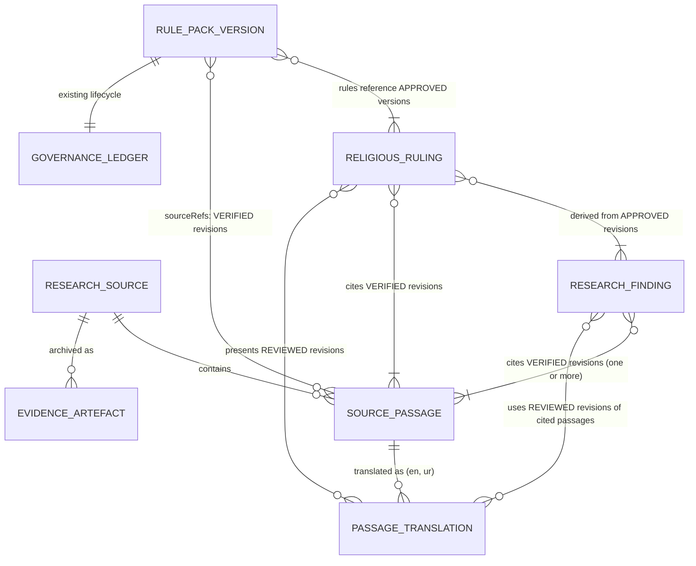
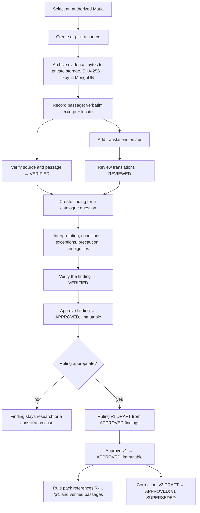

# Scholar Research Management — Architecture & Schema Design (M5.3)

> **Status:** **APPROVED WITH REQUIRED CHANGES** by the owner (2026-11-22). This document is the
> final M5.3.1 design; all 13 design decisions are resolved (§14). M5.3.2 (domain foundations) is
> authorized; M5.3.3 and later need a separate milestone review. M5.3.2 acceptance fixes
> (2026-11-22, after the implementation audit): stale-revision refusal, cumulative AI involvement,
> draft-time reference resolution, replay integrity (staff actors, recomputed display references,
> supported catalogue revisions) and exhaustive lifecycle tests (§3, §4.1, §4.4, §5, §12). Final
> hardening: append-only AI declaration corrections with provenance (§4.4) and the pinned-revision
> policy, including disputes since the pin (§2.1).
>
> **M5.3.6 complete (final acceptance review passed 2026-11-22; closed on the owner's instruction):** rule-pack
> `rulingRefs` cite exact ruling versions; staff-only scholar-review packs may cite properly
> sourced DRAFT versions (the scholar reviews real rules in action), production needs the current
> APPROVED version; every pack version carries an in-pack snapshot of each cited ruling and its
> finding → passage → source chain (§9 "As built"). Machinery only: no real rule content exists
> until the scholar records sourced findings and rulings. Provisional results stay staff-only,
> labelled **PROVISIONAL — FOR SCHOLAR REVIEW ONLY**.
>
> **M5.3.5 complete (final acceptance review passed 2026-11-22; closed on the owner's instruction):** ruling correction versions, series
> identity (`rulingSeriesId`), supersession on approval of the next version, and the current-version
> view (§8.3). Earlier versions are never changed; supersession appends one record to the previous
> version's chain in the same transaction. No rule-pack or calculation use (M5.3.6).
>
> **M5.3.4 complete (final acceptance review passed 2026-11-22; closed on the owner's instruction):** findings and first-version rulings (§8.2):
> payload schemas, the D14 citation rule in core, the `researchFindings` and `religiousRulings`
> collections, routes on the existing research API, audit, checkpoints and tests. Ruling correction
> versions, series identity and supersession remain M5.3.5. No rule-pack or calculation use (M5.3.6).
>
> **Acceptance audit (2026-11-22):** end-to-end review of M5.3.1–M5.3.3. Fixed: a cross-Marja
> existence leak through reference refusals, unaudited out-of-scope commands, missing Marja
> attribution on refusal events, unaudited storage conflicts during upload, list paging that could
> skip records created in the same millisecond, and the refusal order for terminal records with
> references (§5). Catalogue ids are now pinned by a test.
>
> **M5.3.3 implemented (2026-11-22, awaiting review):** sources, evidence artefacts, passages and
> translations — collections, validators, indexes, least-privilege roles, NestJS endpoints (§8.1),
> strict contracts, transactional persistence with audit, research chains in integrity checkpoints,
> API client and tests. **Evidence storage is NOT production-ready:** no durable, private,
> encrypted, no-cost provider exists on the approved deployment, so production refuses evidence
> uploads (§4.3.1). M5.3.4 (findings) has not started.
>
> No religious content, sources or rulings are defined here. Examples use placeholders only.
> Initial research scope: `sistani` and `khamenei`; the architecture stays multi-Marja.
>
> Legend: **[IMPL]** implemented · **[PART]** partially implemented · **[NEW]** not implemented ·
> **[M5.3.2]** delivered by M5.3.2.

Related: `docs/research/` (standards, templates, matrix; documentation revision 6),
`docs/research/RULE_PACK_STRUCTURE.md`, `docs/RELIGIOUS_RULES.md`, `docs/DATABASE_SCHEMA.md`,
`docs/AUTH_ARCHITECTURE.md`.

---

## 1. Current architecture (reused, not duplicated)

| Capability                                                                                           | Where                                                                                   | Status | Reuse                                                                      |
| ---------------------------------------------------------------------------------------------------- | --------------------------------------------------------------------------------------- | ------ | -------------------------------------------------------------------------- |
| Append-only collections (insert + exact-match find; unique-index conflict detection; in-memory twin) | `apps/api/src/persistence/append-only-collection.ts`, `mongo-append-only-collection.ts` | [IMPL] | Every research collection is append-only                                   |
| Collection specs → migration → validators, indexes → least-privilege roles                           | `persistence/collections.ts`, `migrate.ts`, `database-roles.ts`                         | [IMPL] | New specs; roles derive automatically                                      |
| Transactional unit of work (whole-unit retry)                                                        | `persistence/unit-of-work.ts`                                                           | [IMPL] | One revision + its audit event per command                                 |
| Hash-chained, replay-verified chains                                                                 | `@khums/core` governance ledger, provisional chains                                     | [IMPL] | Pattern of the research revision chain                                     |
| Hash-chained audit log; denials and refusals audited                                                 | `audit/*`, `GovernanceService.recordRefusal`                                            | [IMPL] | Research events in the same chain                                          |
| Signed integrity checkpoints, offline archive                                                        | `integrity/*`, operator commands                                                        | [IMPL] | Research chains are checkpointed from the first persisted collection (D11) |
| Authorization engine (catalogue, Marja scope, decisions)                                             | `@khums/core/authorization`                                                             | [IMPL] | Research permissions on `MARJA_RESEARCH` [M5.3.2]                          |
| Staff sessions, CSRF, signed edge, private gate, SUPER_ADMIN restrictions                            | `apps/api/src/auth`, web `proxy.ts`                                                     | [IMPL] | Unchanged                                                                  |
| Strict request / additive response contracts, OpenAPI, RFC 9457                                      | `@khums/validation/api`, `contract-schemas.ts`                                          | [IMPL] | New contracts from M5.3.3                                                  |
| Cursor paging                                                                                        | `apps/api/src/common/paging.ts`                                                         | [IMPL] | All research lists                                                         |
| Write-once, digest-bound content store                                                               | `governance/pack-content.store.ts`                                                      | [IMPL] | Pattern for evidence metadata                                              |
| Rule packs, governance lifecycle, readiness gates                                                    | engine, `core/governance`                                                               | [IMPL] | Gains ruling/source reference resolution (D13)                             |
| `rulingRefs` / `sourceRefs` on rules                                                                 | `shared-types/calculation/rule-pack.ts`                                                 | [PART] | Resolved against research records from M5.3.6                              |
| Staff console framework, localized content, RTL                                                      | `apps/web/src/server/console-*`, `components/console`, `content/*`                      | [IMPL] | Research section from M5.3.7                                               |

**Constraints:** append-only database roles (drafts are revised by appending; deleted by tombstone);
exact-match finds (equality filters, paging after authorization); JSON body limit (~100 KB, so
passages are bounded); pure packages hold all rules; MongoDB is the system of record (D1).

---

## 2. Domain model and relationships

Three strictly separate layers plus shared evidence. Every entity is bound to one Marja at creation;
the binding never changes.



| Layer    | Entity                       | Purpose                                                                                  | Immutable when                          |
| -------- | ---------------------------- | ---------------------------------------------------------------------------------------- | --------------------------------------- |
| Evidence | Research source              | Book edition, istifta' page, office letter, with edition and access metadata             | `VERIFIED`                              |
| Evidence | Evidence artefact            | Metadata of an archived file (SHA-256, storage reference); bytes in private storage (D3) | On insert (write-once)                  |
| Evidence | Source passage               | Verbatim original-language excerpt at an exact locator                                   | `VERIFIED`                              |
| Evidence | Passage translation          | English or Urdu translation of one passage revision                                      | `REVIEWED`                              |
| A        | Research finding             | Scholar's documented investigation of one catalogue question / scenario                  | `APPROVED`                              |
| B        | Religious ruling version     | Scholar-approved interpretation with translations, applicability, dates                  | `APPROVED`                              |
| C        | Rule pack version (existing) | Engine-executable rules referencing exact approved rulings and verified sources          | Submitted / published (existing ledger) |

**Finding citations (D14, owner decision 2026-11-22).** A finding cites **exact passage
revisions**, never a source document directly:

- every finding references **one or more** exact `SOURCE_PASSAGE` revisions (required state
  `VERIFIED` at verification and approval);
- it may also reference `REVIEWED` `PASSAGE_TRANSLATION` revisions, each a translation of a passage
  revision the finding cites;
- source provenance is traced through the passage (finding → passage revision → source revision),
  never by a direct finding → source reference;
- every reference stays within the finding's Marja; revisions stay immutable and pins are history
  (§2.1).

Applied when findings are implemented (M5.3.4); see §15.

**Every reference is pinned** to an exact revision (sources, passages, translations, findings) or
an exact version (rulings) of the same Marja, and must be in the required state at that revision.
References are resolved when they are written and again on every approval-type transition; core
refuses content with references when no resolver is supplied (`REFERENCES_UNRESOLVED`), so
validation is never skipped. The exact rules are in §2.1.
A later correction never changes what an approved record referred to. Nothing is ever generated
automatically from a lower layer.

### 2.1 Pinned-revision policy [M5.3.2]

A reference names an exact revision of its target. What happened to the target **after** that
revision decides whether the reference may still be used:

| Target after the pinned revision                           | Drafting (CREATE, REVISE) | Verification / review / approval (VERIFIED, REVIEWED, APPROVED) |
| ---------------------------------------------------------- | ------------------------- | --------------------------------------------------------------- |
| Nothing (pinned revision is the latest)                    | allowed                   | allowed if the pinned revision is in the required state         |
| `SUPERSEDED` (a newer record replaced it)                  | allowed                   | allowed: a historical pin stays valid                           |
| `DISPUTED` (at any point, even if later `SUPERSEDED`)      | allowed                   | refused `REFERENCE_DISPUTED`                                    |
| `WITHDRAWN`                                                | allowed                   | refused `REFERENCE_WITHDRAWN`                                   |
| `DELETED` (draft tombstone)                                | refused                   | refused `REFERENCE_DELETED`                                     |
| Pinned revision not in the required state (e.g. its DRAFT) | allowed                   | refused `REFERENCE_STATE_INVALID`                               |

Required states: sources and passages `VERIFIED`, translations `REVIEWED`, findings and ruling
versions `APPROVED`. Drafting also always requires that the target exists and replays, matches its
entity type, id and ruling version, has that revision and belongs to the same Marja. A newer
revision or a superseding record never invalidates a pin on its own; a dispute or withdrawal since
the pin always blocks verification and approval. Once the referring record is itself approved it
stays approved (pins are history); a later dispute of a cited item is a matter for the scholar
(e.g. a new version), not an automatic change. The check is not transitive: a cited finding's own
citations were checked when that finding was verified and approved.

---

## 3. Identifiers (D8)

- **Internal id:** a **UUIDv7** per entity (time-ordered, collision-resistant, immutable), generated by
  the API from the injected clock and a CSPRNG. No database counters and no `max + 1` allocation.
- **Readable reference (optional, human-facing):** `S-`, `P-`, `T-`, `F-`, `R-` + Marja + a code
  derived from the UUID's random bits (Crockford base32), e.g. `F-sistani-INC-01-7K3QX9MZ`. Unique
  (unique index; on the rare collision the API re-derives from a new UUID), stable, never reused.
  For findings the catalogue question id is embedded. Pure derivation: `@khums/core`
  `researchDisplayRef` [M5.3.2]; replay recomputes it from the UUID, Marja, entity type and
  question and rejects a record whose stored reference differs.
- **Record id:** `${entityId}#${revision}`; the Marja binding is part of revision 0 and identical in
  every revision.

---

## 4. Storage design

### 4.1 The research revision chain [M5.3.2: domain]

Each entity is an append-only, hash-chained list of **full-snapshot** revision records, replayed and
verified by `@khums/core` on every read (the provisional-chain pattern).

```ts
interface ResearchRevisionRecord {
  readonly entityType: 'SOURCE' | 'PASSAGE' | 'TRANSLATION' | 'FINDING' | 'RULING';
  readonly entityId: string; // UUIDv7
  readonly displayRef: string; // readable reference, identical in every revision
  readonly marjaId: string; // bound at revision 0
  readonly rulingVersion: number | null; // RULING: ≥ 1; others: null
  readonly revision: number; // 0-based, contiguous
  readonly recordId: string; // `${entityId}#${revision}`
  readonly kind: ResearchRevisionKind; // CREATED | REVISED | VERIFIED | REVIEWED | APPROVED | DISPUTED | SUPERSEDED | WITHDRAWN | DRAFT_DELETED
  readonly payload: Readonly<Record<string, unknown>> | null; // content snapshot (CREATED/REVISED only)
  readonly payloadDigest: string | null; // canonical SHA-256 of payload
  readonly references: readonly ResearchReference[]; // pinned, same Marja (CREATED/REVISED only; carried forward)
  readonly aiInvolvement: readonly AiInvolvement[]; // per content revision (see §4.4)
  readonly actor: GovernanceActorRef; // STAFF_PRINCIPAL only (session principal, never client-supplied)
  readonly recordedAt: string; // server time, non-decreasing
  readonly reason: string | null; // required for DISPUTED, WITHDRAWN, DRAFT_DELETED
  readonly decisionId: string;
  readonly requestId: string;
  readonly previousRecordDigest: string | null;
  readonly recordDigest: string;
}
interface ResearchReference {
  readonly entityType: ResearchEntityType;
  readonly entityId: string;
  readonly revision: number; // for RULING references: the version's revision that APPROVED it
  readonly rulingVersion: number | null;
  readonly marjaId: string; // must equal the referring record's Marja
}
```

Findings also carry `question: { id, catalogueRevision }`, bound at revision 0: the catalogue
revision must be a supported one (`SUPPORTED_CATALOGUE_REVISIONS`) containing that question, and
neither field may change in a later revision. Replay also requires every actor to be a
`STAFF_PRINCIPAL` (research has no legacy records; governance ledgers keep their own actor rules).

Entity-specific payload schemas (source metadata, passage text, translation, finding, ruling) are
validated in their own milestones (M5.3.3–M5.3.5); the envelope, references and lifecycle are
validated generically now.

### 4.2 Collections (all `APPEND_ONLY`; created from M5.3.3)

| Collection            | Why                                                                                     | Unique indexes                                               | Other indexes                                | Reuses                                       |
| --------------------- | --------------------------------------------------------------------------------------- | ------------------------------------------------------------ | -------------------------------------------- | -------------------------------------------- |
| `researchSources`     | Source records and verification history                                                 | `{entityId,revision}`, `{recordId}`, `{displayRef,revision}` | `{marjaId,revision}`                         | Revision chain, unit of work, audit          |
| `evidenceArtefacts`   | Write-once evidence metadata: SHA-256, size, media type, provider key, copyright status | `{digest}`                                                   | `{sourceId}`, `{marjaId}`                    | `rulePackContents` write-once pattern        |
| `sourcePassages`      | Verbatim excerpts at locators                                                           | as sources                                                   | `{marjaId,revision}`, `{sourceId}`           | Revision chain                               |
| `passageTranslations` | Translations apart from the original                                                    | as sources                                                   | `{passageId,language}`                       | Revision chain                               |
| `researchFindings`    | Layer A                                                                                 | as sources                                                   | `{marjaId,revision}`, `{marjaId,questionId}` | Revision chain, question catalogue           |
| `religiousRulings`    | Layer B; one chain per ruling version                                                   | `{entityId,rulingVersion,revision}`, `{recordId}`            | `{marjaId}`, `{rulingSeriesId}`              | Revision chain, supersession like the ledger |

No counter collection exists (D8). Existing `rulePackContents`, `governanceLedgerRecords` and
`auditEvents` are unchanged.

**As built in M5.3.3** (`apps/api/src/persistence/collections.ts`): each revision document stores the
exact record as `recordJson` (verified against `recordDigest` on every replay; no BSON type drift and
no field-name limits on payload keys) plus index copies cross-checked on load; passages carry
`sourceId`, translations `passageId` and `language` (their immutable bindings). One refinement:
`evidenceArtefacts` is unique on `{artefactId}` and **`{marjaId, digest}`** (not `{digest}` alone),
so the same file in two Marjas is two artefacts and an upload never reveals that a file exists in
another Marja. The checkpoint role reads the research chain collections.

**As built in M5.3.4–M5.3.5:** `researchFindings` and `religiousRulings` use the same chain
indexes as sources (each ruling version is its own chain with its own UUIDv7, so `{entityId,
revision}` identifies a revision), plus `{marjaId, questionId}` for findings and the unique
**`{rulingSeriesId, rulingVersion, revision}`** for rulings (one version number per series: of two
concurrent corrections exactly one commits). Index copies: `questionId` (findings), `rulingVersion`
and `rulingSeriesId` (rulings). `rulingSeriesId` is also an immutable field of every ruling record
(hash-chained; absent on every other entity type, whose records and digests are unchanged).

**Why per-Marja rather than global digest uniqueness (owner decision 2026-11-22: retained).** A
global `{digest}` index would make the second upload of a file fail when the file is already
evidence in any Marja, which tells a scholar of one Marja that a specific document exists in another
Marja's research (a cross-Marja information leak), and it would bind one artefact to sources of two
Marjas, breaking Marja isolation of history, access and later removal. Per-Marja uniqueness keeps
each Marja's evidence independent: the same bytes in two Marjas are two artefacts with two storage
keys (`sistani/<sha256>`, `khamenei/<sha256>`), at the small cost of storing the ciphertext twice.

**Duplicate uploads within a Marja are idempotent and safe**: the same bytes for the same source
return the existing artefact (HTTP 200, nothing new recorded or audited) after re-storing the bytes,
which repairs missing storage and restarts an orphan's grace period; the same bytes for another
source of the Marja are refused (409, naming the existing artefact id); a concurrent duplicate that
loses the unique index resolves to the committed artefact.

### 4.3 Evidence storage (D3)

```ts
/** Provider-independent private storage for evidence bytes (apps/api; platform code). */
interface EvidenceStorage {
  /** Stores bytes encrypted at rest under a provider key; returns the key. Idempotent by digest. */
  put(
    digest: string,
    bytes: Uint8Array,
    mediaType: string,
  ): Promise<Result<{ key: string }, 'UNAVAILABLE'>>;
  /** Returns the bytes; the CALLER recomputes SHA-256 and refuses a mismatch (EVIDENCE_DIGEST_MISMATCH). */
  get(key: string): Promise<Result<Uint8Array, 'NOT_FOUND' | 'UNAVAILABLE'>>;
}
```

- MongoDB stores only metadata, the SHA-256 and the provider key (immutable reference).
- Bytes live in private, access-controlled, encrypted storage behind `EvidenceStorage`. Initial
  provider: an encrypted local/maintainer-held store; **no paid storage without owner approval**.
- SHA-256 is verified on every retrieval; mismatches are integrity incidents.
- Copyright: `copyright` ∈ `UNKNOWN | PERMITTED | RESTRICTED | EXCERPTS_ONLY`; complete documents
  are stored only with `PERMITTED` (D10); access restrictions of websites are never bypassed.
- Backups: evidence bytes are backed up with the encrypted backup procedure
  (`DEPLOYMENT_FREE_TIER.md` §7), and a restore drill re-verifies every digest.

#### 4.3.1 Status after M5.3.3 (deployment check)

| Requirement                       | Status                                                                                                                                                                                                                                                                                                                                                                                                                                                         |
| --------------------------------- | -------------------------------------------------------------------------------------------------------------------------------------------------------------------------------------------------------------------------------------------------------------------------------------------------------------------------------------------------------------------------------------------------------------------------------------------------------------- |
| Provider-independent interface    | **Done.** `EvidenceStorage` (`apps/api/src/research/evidence-storage.ts`): `put`/`get`/`keys`; keys `${marjaId}/${sha256}`.                                                                                                                                                                                                                                                                                                                                    |
| Metadata only in MongoDB          | **Done.** `evidenceArtefacts`: digest, size, media type, copyright, extent, storage key; never the bytes.                                                                                                                                                                                                                                                                                                                                                      |
| SHA-256 on every retrieval        | **Done.** Computed on upload (must equal the client's), re-checked with size on every read; a mismatch answers 503, is logged (ids only) and audited (`research.evidence.integrity.failure`); bytes are never returned.                                                                                                                                                                                                                                        |
| Encryption                        | **Done (local provider).** AES-256-GCM, random nonce per file, the storage key as AAD (a moved/swapped file fails), key id in the header; files 0600, directories 0700, atomic writes. The key comes from `KHUMS_EVIDENCE_KEY` (secret, never logged).                                                                                                                                                                                                         |
| Backup and verified restore       | **Done (functions, CLI, drill tests).** `backupLocalEvidence` copies ciphertext with a manifest (key ids, never keys); `verifyLocalEvidenceBackup` checks every ciphertext hash, authenticated decryption and plaintext SHA-256; `restoreLocalEvidence` writes nothing unless all of that passes and never overwrites; `verifyEvidence` checks every artefact against MongoDB metadata. CLI: DEPLOYMENT_FREE_TIER.md §7.2.                                     |
| Key backup, recovery, rotation    | **Done (documented + tested).** DEPLOYMENT_FREE_TIER.md §7.2; `reencryptLocalEvidence` (`--rotate-evidence-key`) re-encrypts into a new directory and verifies every file; the old directory is never changed.                                                                                                                                                                                                                                                 |
| Orphans                           | **Done.** §4.3.2.                                                                                                                                                                                                                                                                                                                                                                                                                                              |
| Durable on the private deployment | **NOT AVAILABLE.** Render Free has an ephemeral filesystem; Atlas M0 has no backups and bytes stay out of MongoDB by design; every other durable option is a new external service or paid storage, which needs owner approval. **Production therefore always gets the unavailable provider**: evidence uploads and downloads answer 503 `EVIDENCE_STORAGE_UNAVAILABLE`, and `KHUMS_EVIDENCE_DIR`/`KHUMS_EVIDENCE_KEY` are refused in production configuration. |
| Development / maintainer machines | The local encrypted provider (`KHUMS_EVIDENCE_DIR` on a persistent, encrypted, backed-up disk); memory otherwise (lost on restart).                                                                                                                                                                                                                                                                                                                            |

Store-then-commit: bytes are stored first (content-addressed and idempotent), then the metadata and
its audit event commit in one transaction; a failed commit leaves only unreferenced ciphertext
(reported by `verifyEvidence`), never metadata without bytes.

#### 4.3.2 Orphaned evidence (M5.3.3 hardening)

- **Inventory** (`evidenceOrphanInventory`, `--evidence-orphans`): read-only; every stored key that
  no committed artefact refers to, with the time it was last stored. Referenced keys are never
  listed. Keys younger than the grace period (default 7 days, minimum 1) are not eligible: they may
  belong to an upload in flight or about to be retried.
- **Re-store refreshes age**: storing bytes that already exist updates their stored time, so a
  retried upload of an orphan restarts its grace period before it commits.
- **Cleanup** (`deleteEvidenceOrphans`, `--delete-evidence-orphans`): operator-run; needs the exact
  key list (at most 50) and the typed confirmation `DELETE <n> EVIDENCE ORPHANS`; audits the intent
  first (nothing is deleted if that audit fails) and the outcome after; immediately before each
  deletion re-checks that the key is still unreferenced and past the grace period, so referenced
  evidence is never deleted even if listed by mistake. Audit details: keys (Marja + SHA-256), counts
  and reason codes only.
- **Failure injection** (tests): a failed audit or metadata insert leaves only an orphan, which a
  retried upload recovers; cleanup skips keys re-stored or committed since the inventory.

### 4.4 AI involvement record [M5.3.2]

```ts
interface AiInvolvement {
  readonly assistance:
    | 'SOURCE_LOCATING'
    | 'OCR_TEXT_EXTRACTION'
    | 'TRANSLATION_DRAFT'
    | 'DUPLICATE_DETECTION'
    | 'CONSISTENCY_CHECK';
  readonly field: string; // affected content path, e.g. 'payload.text'
  readonly generation: 'AI_GENERATED' | 'MACHINE_ASSISTED';
  readonly tool: string; // tool/model name as declared
  readonly occurredAt: string;
  readonly scholarReview: 'NOT_REVIEWED' | 'REVIEWED_UNCHANGED' | 'REVIEWED_CORRECTED';
}
```

**Cumulative declarations.** A declaration's identity is `assistance`, `field`, `generation`, `tool`
and `occurredAt`. Every content revision (REVISED) must repeat every declaration of the previous
content revision unchanged (`AI_DECLARATION_REMOVED` otherwise, which also covers an altered
declaration or correction link); `scholarReview` may move once from `NOT_REVIEWED` to
`REVIEWED_UNCHANGED` or `REVIEWED_CORRECTED` and never changes again (`AI_REVIEW_REGRESSED`); new
declarations may be added; duplicates in one revision are refused (`AI_DECLARATION_DUPLICATE`).

**Corrections (append-only).** A declaration recorded wrongly is never deleted or edited. A later
revision adds a correction: a new declaration with `correctionOf` (the original's identity) and
`correctionReason` (3–500 characters, trimmed). Core requires the reason
(`AI_CORRECTION_REASON_REQUIRED`), refuses a reason without a link (`AI_CORRECTION_INVALID`),
requires the original to be in the previous content revision and not already corrected
(`AI_CORRECTION_TARGET_INVALID`; so no correction at creation, no correcting a declaration added in
the same revision, one correction per declaration; a correction may itself be corrected), and
requires the correction to start `NOT_REVIEWED` (`AI_CORRECTION_REVIEW_INVALID`). The original stays
in every later revision with its own review state.

**Review gate.** Core refuses `VERIFIED`, `REVIEWED` and `APPROVED` while any **effective**
declaration (one not corrected) is `NOT_REVIEWED` (`AI_REVIEW_REQUIRED`). A correction replaces the
original in the gate and itself starts unreviewed, so correcting never skips review. The same rules
apply on replay.

**Provenance.** `researchAiProvenance(chain)` replays the chain and lists every declaration ever
made with the trusted metadata (revision, record id, staff actor, server time) of where it was
declared, reviewed and corrected, and whether it is still effective. Corrections reuse the record
envelope's actor and time; nothing is client-supplied. AI never approves,
interprets authoritatively or publishes; no AI feature is built in M5.3.

### 4.5 Question catalogue (D7) [M5.3.2]

A version-controlled constant in `@khums/core` (`RESEARCH_QUESTION_CATALOGUE`, revision
`research-matrix-rev5-required`): the **70 required questions** of RESEARCH_MATRIX §2 (62 in 11
topics + 8 `CTQ`), stable ids, no proposed additions or promotions (owner decision #10 pending).
Findings record the catalogue revision they were written against.

---

## 5. Lifecycles [M5.3.2: transition validation]

| Entity          | States (derived)                                                                                                                    | Content edits                               | Approval-type transition |
| --------------- | ----------------------------------------------------------------------------------------------------------------------------------- | ------------------------------------------- | ------------------------ |
| Source, Passage | `DRAFT → VERIFIED`; `VERIFIED → DISPUTED → (new revision only via SUPERSEDED)`; `DRAFT → DELETED`; `VERIFIED/DISPUTED → SUPERSEDED` | `REVISED` in `DRAFT` only                   | `VERIFIED`               |
| Translation     | `DRAFT → REVIEWED`; `REVIEWED → DISPUTED`; `DRAFT → DELETED`; `REVIEWED/DISPUTED → SUPERSEDED`                                      | `DRAFT` only                                | `REVIEWED`               |
| Finding         | `DRAFT → VERIFIED → APPROVED`; `VERIFIED → DRAFT` (via `REVISED`); `APPROVED → SUPERSEDED/WITHDRAWN`; `DRAFT/VERIFIED → DELETED`    | `DRAFT`, or `VERIFIED` (returns to `DRAFT`) | `VERIFIED`, `APPROVED`   |
| Ruling version  | `DRAFT → APPROVED → SUPERSEDED/WITHDRAWN`; `DRAFT → DELETED`                                                                        | `DRAFT` only                                | `APPROVED`               |

```mermaid
stateDiagram-v2
  [*] --> DRAFT: CREATED
  DRAFT --> DRAFT: REVISED (expectedRevision)
  DRAFT --> DELETED: DRAFT_DELETED (reason; tombstone)
  DRAFT --> APPROVED: APPROVED (the same scholar may approve)
  APPROVED --> SUPERSEDED: SUPERSEDED (newer version / record)
  APPROVED --> WITHDRAWN: WITHDRAWN (reason)
  SUPERSEDED --> [*]
  WITHDRAWN --> [*]
  DELETED --> [*]
```



Terminal: `DELETED`, `SUPERSEDED`, `WITHDRAWN`. Content is frozen in `APPROVED` (findings, ruling
versions), `REVIEWED` (translations) and `VERIFIED` (sources, passages). A `VERIFIED` finding is not
frozen: the explicitly allowed `REVISED` transition returns it to `DRAFT`, after which it must be
verified again. Every state × action combination is covered by table-driven tests written from this
table. REVISE and every transition carry `expectedRevision` (§12).
Tombstones keep every earlier revision and the audit trail (D2).

---

## 6. Scholar workflow



The same authorized scholar may perform every step; no step requires another person (D5).

---

## 7. Authorization matrix (D4, D5, D6) [M5.3.2]

Resource: `MARJA_RESEARCH { marjaId }`. The Marja is taken from the stored entity for every command
except creation, where it is checked against the caller's scope, the catalogue and the initial
research scope (D12, `INITIAL_RESEARCH_MARJAS = ['sistani', 'khamenei']`). Separation rule `NONE`
for every research permission: research authorization never consults a governance policy, so no
configuration can reintroduce a second person.

| Permission                                        | GOVERNING_SCHOLAR | RELIGIOUS_RESEARCHER | SUPER_ADMIN | AUDITOR | Others |
| ------------------------------------------------- | :---------------: | :------------------: | :---------: | :-----: | :----: |
| `research.read` (content, interpretations, notes) |         ✓         |          —           |      —      |    —    |   —    |
| `research.audit.read` (history and metadata only) |         ✓         |          —           |      —      |    ✓    |   —    |
| `research.source.record`                          |         ✓         |     — (removed)      |      —      |    —    |   —    |
| `research.source.verify`                          |         ✓         |          —           |      —      |    —    |   —    |
| `research.translation.edit`                       |         ✓         |          —           |      —      |    —    |   —    |
| `research.translation.review`                     |         ✓         |          —           |      —      |    —    |   —    |
| `research.finding.edit`                           |         ✓         |     — (removed)      |      —      |    —    |   —    |
| `research.finding.verify`                         |         ✓         |          —           |      —      |    —    |   —    |
| `research.finding.approve`                        |         ✓         |          —           |      —      |    —    |   —    |
| `research.ruling.edit`                            |         ✓         |          —           |      —      |    —    |   —    |
| `research.ruling.approve`                         |         ✓         |          —           |      —      |    —    |   —    |
| `research.ruling.withdraw`                        |         ✓         |          —           |      —      |    —    |   —    |

`RELIGIOUS_RESEARCHER` keeps only non-authoritative operational permissions. SUPER_ADMIN keeps the
general `audit.log.read` (ids and codes) and gains nothing here.

**Superseded in part by ARCHITECTURE decision 64 (2026-11-23):** `SCHOLAR` (the grantable successor
of `GOVERNING_SCHOLAR`, which still acts identically) holds the column above for its assigned Marjas
and `research.read` for every other Marja (read-only); `SUPER_ADMIN` holds every research
permission on every Marja. The legacy roles keep the rest of this table unchanged.

---

## 8. API endpoint specification (from M5.3.3)

All under `/api/v1/admin/research` (staff routes: session, CSRF, `no-store`, signed edge,
`@ApiContractResponse`). Out-of-scope or unknown ids answer 404 `RESEARCH_NOT_FOUND`.

| Method & path                                                                        | Permission                                               | Notes                                                                                     |
| ------------------------------------------------------------------------------------ | -------------------------------------------------------- | ----------------------------------------------------------------------------------------- |
| `GET /marjas`                                                                        | any research permission                                  | Caller's research Marjas (scope ∩ initial scope)                                          |
| `GET /{type}?marjaId=&state=&questionId=&cursor=&limit=`                             | `research.read`                                          | Content views; `type` ∈ sources, passages, translations, findings, rulings                |
| `GET /{type}/metadata?marjaId=&…`                                                    | `research.audit.read`                                    | Ids, display refs, states, actors, times; **no content** (auditors)                       |
| `POST /sources`, `/passages`, `/passages/{id}/translations`, `/findings`, `/rulings` | create permission                                        | `{ marjaId (create only), payload, references, aiInvolvement }`                           |
| `POST /{type}/{id}/revise`                                                           | edit permission                                          | `{ expectedRevision, payload, references, aiInvolvement }`                                |
| `POST /{type}/{id}/verify` · `/review` · `/approve`                                  | verify / review / approve                                | `{ expectedRevision }`                                                                    |
| `POST /{type}/{id}/dispute` · `/withdraw` · `/delete-draft`                          | edit / withdraw                                          | `{ expectedRevision, reason }` (reason mandatory)                                         |
| `POST /rulings/{id}/versions`                                                        | `research.ruling.edit`                                   | New DRAFT version n+1 from n (correction)                                                 |
| `POST /sources/{id}/evidence`                                                        | `research.source.record`                                 | Upload bytes (size-capped); server hashes, stores via `EvidenceStorage`, records metadata |
| `GET /evidence/{digest}`                                                             | `research.read`                                          | Streams bytes after SHA-256 re-verification                                               |
| `GET /{type}/{id}/history`                                                           | `research.read` or `research.audit.read` (metadata view) | Revision list                                                                             |
| `GET /export?marjaId=`                                                               | `research.read`                                          | Controlled export (JSON, verified chains) for review/backup (D1)                          |

Errors: `RESEARCH_NOT_FOUND` 404, `RESEARCH_CONFLICT` 409, `RESEARCH_REFUSED` 409 (issue codes in
`detail`), `EVIDENCE_DIGEST_MISMATCH` 500 (integrity incident, audited), existing
`ACCESS_DENIED` 403, `VALIDATION_FAILED` 400, `PAYLOAD_TOO_LARGE` 413. No submitted content in
problems or logs. Paging via `pageOf` cursors; equality filters only.

---

### 8.1 Implemented in M5.3.3

All staff routes under `/api/v1/admin/research` (session, CSRF on commands, signed edge, strict
request contracts, `@ApiContractResponse`); OpenAPI in `apps/api/openapi.json`; client
`@khums/api-client` `research.*`. `{type}` ∈ `sources | passages | translations` (findings and
rulings later).

| Method & path                                                            | Permission (core)                                      | Notes                                                                                                                             |
| ------------------------------------------------------------------------ | ------------------------------------------------------ | --------------------------------------------------------------------------------------------------------------------------------- |
| `GET /marjas`                                                            | any research permission                                | Initial-scope Marjas and the caller's research permissions in each                                                                |
| `GET /{type}?marjaId=&state=&limit=&cursor=`                             | `research.read`                                        | List with a short label (source title, passage locator, translation language), never excerpt or translation text                  |
| `GET /{type}/metadata?marjaId=&limit=&cursor=`                           | `research.audit.read`                                  | Auditor view (D6): ids, states, actors, times, digests, `hasReason`; no content, no reasons                                       |
| `POST /{type}`                                                           | `research.source.record` / `research.translation.edit` | `{ marjaId, payload, references, aiInvolvement }`; the server draws the UUIDv7 (retries on collision)                             |
| `GET /{type}/{id}`                                                       | `research.read`                                        | Current content, revision summaries, AI provenance (`researchAiProvenance`)                                                       |
| `GET /{type}/{id}/metadata`                                              | `research.audit.read` or `research.read`               | One record's history metadata                                                                                                     |
| `GET /{type}/{id}/revisions/{n}`                                         | `research.read`                                        | One exact revision, its state, and the content a pin to it refers to                                                              |
| `POST /{type}/{id}/revise`                                               | edit permission                                        | `{ expectedRevision, payload, references, aiInvolvement }`                                                                        |
| `POST /{type}/{id}/verify · review · dispute · supersede · delete-draft` | verify / review / edit permission                      | `{ expectedRevision, reason }` (reason required for dispute and delete-draft)                                                     |
| `POST /evidence`                                                         | `research.source.record`                               | `{ sourceId, mediaType, sha256, copyright, extent, description, contentBase64 }` (≤ 2 MiB; only this route has a 3 MB body limit) |
| `GET /evidence?sourceId=`                                                | `research.read`                                        | Metadata of a source's files                                                                                                      |
| `GET /evidence/{artefactId}` · `/content`                                | `research.read`                                        | Metadata · bytes (base64) after SHA-256 and size re-verification                                                                  |

Differences from the planned table above (none changes a decision): translations are created with
`POST /translations` citing their passage revision (not a nested path); evidence is addressed by
artefact id (not digest, which is per Marja); history is `…/metadata` and `…/revisions/{n}`;
`RESEARCH_REFUSED` is 422 (domain refusal) and `RESEARCH_CONFLICT` 409 (stale `expectedRevision` or
a lost race); a retrieval integrity failure is 503 (logged and audited, bytes never returned);
export is M5.3.8.

Evidence lookups answer 404 `EVIDENCE_NOT_FOUND` (unknown and out-of-scope artefacts alike).

Guarantees: records you cannot read answer 404 (outside your Marjas, or unknown), and commands on
them are audited as `research.action.denied`; a reference to another Marja's record is refused
exactly like an unknown id (`REFERENCE_NOT_FOUND`), so refusals never reveal that it exists;
refusal, denial and integrity events carry the record's Marja in `marjaIds`; the Marja of an
existing record always comes from its stored chain; every revision and its audit event
(`research.record.appended`, ids and codes only) commit in one MongoDB transaction; refusals and
denials change nothing and are audited (`research.action.refused` / `research.action.denied`).

### 8.2 Implemented in M5.3.4: findings and first-version rulings

The same routes as §8.1 with `{type}` ∈ `findings | rulings`, plus the transition actions `approve`
and `withdraw` (reason required). `POST /findings` takes `questionId` (one of the 70 required
catalogue questions; refused `QUESTION_UNKNOWN` otherwise, `QUESTION_NOT_ALLOWED` on other types);
`GET /findings?questionId=` filters by question. Responses carry `questionId` (findings) and
`rulingVersion` (rulings).

| Entity  | Payload (`FindingPayload`, `RulingPayload`)                                                                                                                              | References (exact revisions, same Marja)                                                                                                                                                              | Lifecycle (§5) and permission (§7)                                                                                              |
| ------- | ------------------------------------------------------------------------------------------------------------------------------------------------------------------------ | ----------------------------------------------------------------------------------------------------------------------------------------------------------------------------------------------------- | ------------------------------------------------------------------------------------------------------------------------------- |
| Finding | language, scenario, conclusion, explanation, precaution (`FATWA` … `UNDETERMINED`, as the text states), conditions, exceptions, qualifications, unresolved issues, notes | ≥ 1 `PASSAGE`; optional `TRANSLATION`s, each translating a cited passage revision (same passage, same content); never `SOURCE` (D14). At verify/approve: passages `VERIFIED`, translations `REVIEWED` | `DRAFT → VERIFIED → APPROVED → WITHDRAWN/SUPERSEDED`; `research.finding.edit/verify/approve`                                    |
| Ruling  | language, conclusion, explanation, precaution, conditions, exceptions, notes                                                                                             | ≥ 1 `FINDING` and ≥ 1 `PASSAGE`; optional `TRANSLATION`s of cited passages. At approval: findings `APPROVED`, passages `VERIFIED`, translations `REVIEWED`                                            | `DRAFT → APPROVED → WITHDRAWN/SUPERSEDED`; versions and supersession per §8.3 (M5.3.5); `research.ruling.edit/approve/withdraw` |

Refusal codes added: `PASSAGE_REFERENCE_REQUIRED`, `FINDING_REFERENCE_REQUIRED`,
`TRANSLATION_PASSAGE_NOT_CITED`, `QUESTION_NOT_ALLOWED` (M5.3.5 adds the series codes of §8.3). Only an
`APPROVED` ruling is approved religious knowledge; drafts and withdrawn rulings are research records
only; rule packs cite rulings only as §9 allows (M5.3.6). Findings and rulings of
different Marjas never reference each other; each Marja's are authored separately (nothing is
copied or assumed to be shared). Every revision keeps its actor, time and decision id; approved
content is frozen; deletion is a draft tombstone only.

### 8.3 Implemented in M5.3.5: ruling versions and supersession

| Method & path                 | Permission                 | Notes                                                                                                                                                                   |
| ----------------------------- | -------------------------- | ----------------------------------------------------------------------------------------------------------------------------------------------------------------------- |
| `POST /rulings/{id}/versions` | `research.ruling.edit`     | `{ expectedRevision, payload, references, aiInvolvement }`: a correction of the CURRENT version `{id}` (its chain length as `expectedRevision`) → new DRAFT version n+1 |
| `GET /rulings/{id}/versions`  | `research.read`            | The series of any version: every version with its state, and `current` (the APPROVED version, or null)                                                                  |
| `POST /rulings/{id}/approve`  | `research.ruling.approve`  | Approves the draft version and, in the same transaction, appends `SUPERSEDED` to the previously current version                                                         |
| `POST /rulings/{id}/withdraw` | `research.ruling.withdraw` | Reason required; the version and its history are kept; the series then has no current version                                                                           |

Rules (core `research/rulings.ts`, replayed from storage on every command):

- **Series:** every version has its own UUIDv7 chain; all versions share `rulingSeriesId` (version 1's
  entity id), are numbered 1..n without gaps, and belong to one Marja.
- **Correction:** allowed only when the named version is the series' only `APPROVED` version and no
  other draft exists; the new version is exactly n+1 and cites findings and passages like any ruling.
  The corrected version is not touched (`RULING_CORRECTION_NOT_ALLOWED`, `RULING_VERSION_INVALID`).
- **Supersession:** only by approving the next version; a direct `supersede` is refused
  (`RULING_SUPERSEDED_BY_APPROVAL`). Approval and supersession are one unit of work with two audited
  revisions, so two versions are never current; a stored series with two `APPROVED` or two `DRAFT`
  versions, gaps or mixed Marjas is refused (`RULING_SERIES_INVALID`).
- **Current:** the single `APPROVED` version; superseded and withdrawn versions are never current.
- **Withdrawal while a correction is pending (owner decision 2026-11-22):** the correction can never
  be approved or become current (`RULING_CORRECTION_NOT_ALLOWED`); a new ruling (a new series) is
  required. The withdrawn version and the draft keep their records and history (the draft may be
  deleted by tombstone).

## 9. Rule-pack reference validation (D13, from M5.3.6)

At **governance submit** and **provisional registration**, inside the same unit of work:

1. Every `rulingRefs` entry has the exact form `R-…@version` (or the ruling UUID + version) and
   resolves to an **APPROVED, not WITHDRAWN** ruling version of the **pack's Marja**.
2. Every `sourceRefs` entry resolves to an exact **VERIFIED** source or passage revision of the same
   Marja.
3. The pack content carries an **immutable snapshot** of each referenced ruling version and the
   provenance chain (ruling → findings → passages → sources: ids, revisions, digests, locators).
4. **No restricted copyrighted text** is copied: passage text enters a snapshot only when the
   source's copyright is `PERMITTED`; otherwise only locators and digests.
5. Executable rules are never generated from findings or rulings; packs remain authored content.
6. Refusals: `GOVERNANCE_REFUSED` / `PROVISIONAL_REFUSED` with issue codes
   (`RULING_REFERENCE_UNRESOLVED`, `RULING_NOT_APPROVED`, `REFERENCE_OTHER_MARJA`,
   `SOURCE_REFERENCE_UNRESOLVED`, …).

Historical calculations stay reproducible: packs are immutable and carry their snapshots.

**As built in M5.3.6 (2026-11-22; owner decisions after review):**

- **Reference form:** `rulingRefs` entries are `<ruling entity id (UUIDv7)>@<version>` (the strict
  pack schema accepts this exact form next to legacy identifiers, which are refused as
  `RULING_REFERENCE_INVALID`).
- **Which ruling versions may be used** (core `research/rule-pack-references.ts`, pure):

  | Use                                                                              | Allowed ruling state                                                |
  | -------------------------------------------------------------------------------- | ------------------------------------------------------------------- |
  | Staff-only provisional pack: registration and every calculation                  | `DRAFT` (properly sourced) or `APPROVED`                            |
  | Production pack: governance submission and activation (every rule must cite one) | `APPROVED` only (`RULING_NOT_APPROVED` for a draft)                 |
  | Anywhere                                                                         | never `WITHDRAWN`, `SUPERSEDED` or `DELETED` (`RULING_NOT_CURRENT`) |

  "Properly sourced": the ruling cites at least one finding and one passage, and every finding,
  passage and source in its chain resolves (`RULING_PROVENANCE_INCOMPLETE` otherwise). **A draft
  ruling never means unverified evidence (D14):** every passage revision the ruling or any of its
  findings cites, and each passage's source revision, must be `VERIFIED` at the pinned revision and
  not disputed or withdrawn since (the existing APPROVAL-phase reference rules, §2.1); findings
  cite passages only, never a source (`RULING_EVIDENCE_UNVERIFIED` otherwise). This is checked when
  the snapshot is built and again at every activation and calculation, so evidence disputed later
  stops further use. Always the
  pack's own Marja (unknown, other-Marja and wrong-version references are one code,
  `RULING_REFERENCE_UNRESOLVED`, so nothing reveals another Marja's rulings). Production
  activation still also needs the existing reviewed, approved, published pack version.

- **In-pack snapshots (§9.3, chosen by the owner):** at governance submission and provisional
  registration the server computes, from the research records, a `rulingSnapshots` entry per cited
  ruling version: its id, version, series, state at that time, latest content revision, payload and
  record digests and the scholar's ruling text; each cited finding (pinned revision, digests,
  question, cited passages); each passage cited by the ruling or its findings (pinned revision,
  digests, locator, language, and its source revision with title and copyright). Passage text is
  included only when the source's copyright is `PERMITTED` (§9.4, D10); otherwise locators and
  digests only. The snapshots are added to the stored content and the pack's declared integrity is
  re-sealed over them, so the governance ledger and provisional chain bind the content **with** its
  provenance; snapshots an author supplies must equal the computed ones
  (`RULING_SNAPSHOT_MISMATCH`). The field is optional in every schema version and hashed only when
  present: existing packs keep their content and digests (no new schema version was needed).
- **At the point of use** (activation, every provisional calculation): the ruling's lifecycle is
  re-checked and its current content must still be exactly the snapshotted content
  (`RULING_SNAPSHOT_STALE` for a revised draft: register a new pack version; approval does not
  change content, so a draft-time snapshot stays valid after approval). A ruling withdrawn or
  superseded later therefore stops activation and new calculations, while published or registered
  content, earlier calculations and their exact pack versions and content digests stay as recorded.
  A historical calculation is reproduced by rerunning the deterministic engine path on the version
  it recorded (its content, digest-checked, and its provisional chain); tested end to end.
- **Refusals and audit:** `GOVERNANCE_REFUSED` / `PROVISIONAL_REFUSED` 422 with the codes above,
  audited (`governance.command.refused`; `provisional.action.refused` with issue
  `RULING_REFERENCES_INVALID`); successful submission, activation and registration audit
  `rulingProvenance` = `<rulingId>@<version>:<state at snapshot>:<content record digest>`.
- **Reused, not rebuilt:** pack review is the existing governance `APPROVE` by the
  `GOVERNING_SCHOLAR` under `SINGLE_SCHOLAR_V1` (reviewer and time in the ledger); feedback, issues
  and requested corrections are the existing provisional feedback reports; corrections are new
  ruling versions (M5.3.5) and new pack versions, never edits. Provisional routes stay staff-only
  (no public route serves provisional data).
- **Still open:** `sourceRefs` keep naming the pack's own `sources` list (the snapshot carries the
  research source revisions). Ruling reads happen in the research store, outside the governance and
  provisional transactions; the point-of-use re-check means a withdrawal is never missed where it
  matters. No server-side production calculation path exists yet; when built it must apply the
  production check.

---

## 10. Audit and integrity (D11)

- One unit of work per command: the revision record and one audit event, or neither. Denials and
  refusals are audited in their own unit (existing pattern).
- Audit events: actor (session principal), `marjaIds`, `targets: [{ kind, id }]` (UUID and display
  ref), details: command, record id, revision, ruling version, state, payload digest, decision id,
  reason (withdraw/delete), AI-involvement summary (counts by assistance and review state). Never
  research text, interpretations or translations.
- Integrity: research chains are checkpointed **from the milestone that first persists them**
  (M5.3.3), on a schedule and before approval, release and archival milestones, with the existing
  offline signing, archive and verification. Chain ids: `research:{type}:{entityId}` (e.g. `research:source:<uuidv7>`).
- Retention: no physical deletion through the application; tombstones for drafts.

---

## 11. Frontend (from M5.3.7)

Console section **Research** (`/admin/research`): dashboard with authorized Marjas and catalogue
coverage, findings, sources/evidence/passages, original text with side-by-side translations,
rulings with versions, approval and audit history. Original Arabic/Persian/Urdu text always renders
with its own `lang`/`dir`; UI in English and Urdu (RTL). Auditors see a metadata-only view. The
public calculator never calls research APIs; the private gate and staff routes keep drafts out of
public pages.

**As built in M5.3.7 (2026-11-22, awaiting review):** `/admin/research` (dashboard: the chosen
Marja's progress across the 70 catalogue questions by best finding state, plus the workflow),
`/admin/research/{sources|passages|translations|findings|rulings}` (list with a state filter and a
new-draft form), `/admin/research/{type}/{id}` (current content with field labels, cited exact
revisions with links, revision history, lifecycle actions, revise form while editable, ruling
versions with the current one marked and the correction form) and `/admin/research/history`
(metadata only: who changed which record and when; also for auditors). Server Components read through
the API with the forwarded staff session; Client Components send commands through the browser API
client with CSRF. Which actions and forms appear comes from core (`RESEARCH_TRANSITIONS`,
`REASON_REQUIRED`, `researchPermissionFor`) and the caller's per-Marja permissions from
`GET /marjas`; the API decides every command. Forms are plain fields (no JSON), one line per list
item; references are chosen from records of the Marja in the states approval needs, pinned to their
latest revision. Question wording is not copied: questions show their catalogue id and topic (the
wording stays in RESEARCH_MATRIX §2). Text in English and Urdu (RTL); verbatim text renders with
`dir="auto"`. Passage locators gained an optional `paragraph` (absent in earlier records). Evidence
files are not part of the workspace (production refuses uploads, §4.3.1).

---

## 12. Security and concurrency

Backend authorization only; Marja derived from stored records; create-time Marja validated against
scope, catalogue and initial scope; cross-Marja references refused in core; optimistic concurrency
by `expectedRevision` plus unique `{entityId, revision}`. **Stale commands [M5.3.2]:** REVISE and
TRANSITION carry `expectedRevision` (the chain length the caller saw, `ResearchView.length`); core
refuses a mismatch with `REVISION_CONFLICT`; CREATE takes none. Core only detects stale commands:
two requests evaluated against the same stored chain both pass core and would both be revision
`n`, so **the API (M5.3.3) must persist atomically**: insert the new record inside a transaction
that re-reads the chain, relying on the unique `{entityId, revision}` index so exactly one insert
succeeds, and answer the loser with `REVISION_CONFLICT`; UUIDv7 ids (no allocation races); strict
contracts (no client actor, time, digest, revision); append-only roles; tombstones; SHA-256
re-verification of evidence; no AI endpoints.

---

## 13. Testing strategy and roadmap

| Phase                                            | Deliverables                                                                                                                                                                                                                                                                                                                                                                                                | Depends on    |
| ------------------------------------------------ | ----------------------------------------------------------------------------------------------------------------------------------------------------------------------------------------------------------------------------------------------------------------------------------------------------------------------------------------------------------------------------------------------------------- | ------------- |
| **M5.3.2 (authorized)**                          | Shared types; validation contracts (record, reference, AI involvement, UUIDv7, display refs); core revision chains, lifecycle transitions, same-Marja/state/revision reference checks, AI-review gate; question catalogue; research permissions, GOVERNING_SCHOLAR grants, RELIGIOUS_RESEARCHER and SUPER_ADMIN restrictions, initial research scope; single-scholar self-approval; unit and contract tests | This design   |
| M5.3.3 (implemented, in review)                  | API module: sources, evidence (`EvidenceStorage`, local encrypted provider), passages, translations; collections, migration, roles, audit, contracts, OpenAPI, api-client; **integrity checkpoints for research chains**                                                                                                                                                                                    | M5.3.2 review |
| M5.3.4 ✅ complete (2026-11-22)                  | Findings API and first-version rulings (owner decision 2026-11-22)                                                                                                                                                                                                                                                                                                                                          | M5.3.3        |
| M5.3.5 ✅ complete (2026-11-22)                  | Ruling correction versions, series identity, supersession (implemented)                                                                                                                                                                                                                                                                                                                                     | M5.3.4        |
| M5.3.6 ✅ complete (2026-11-22)                  | Rule-pack `rulingRefs` resolution, in-pack snapshots and provenance (D13)                                                                                                                                                                                                                                                                                                                                   | M5.3.5        |
| M5.3.7 (implemented 2026-11-22, awaiting review) | Web research workspace (en/ur, RTL), Playwright + axe                                                                                                                                                                                                                                                                                                                                                       | M5.3.3–M5.3.5 |
| M5.3.8                                           | Controlled export, backup and restore drill for research data and evidence                                                                                                                                                                                                                                                                                                                                  | M5.3.3        |
| M5.3.9                                           | Docs and hardening                                                                                                                                                                                                                                                                                                                                                                                          | all           |

Tests per phase: core (pure; transitions, tamper detection, references, AI gate, permissions incl.
exhaustive role × permission), validation (strictness, limits), API service (atomic record + audit,
conflicts, scope, refusals audited), HTTP integration (CSRF, 404 out of scope, one-scholar
workflow), web (content coverage, Playwright, axe, RTL). Live Atlas tests only with approval.

---

## 14. Decision log (all resolved 2026-11-22; D14 added after the acceptance audit)

| #   | Decision              | Resolution                                                                                                                                                                                                                                                                                                                                                |
| --- | --------------------- | --------------------------------------------------------------------------------------------------------------------------------------------------------------------------------------------------------------------------------------------------------------------------------------------------------------------------------------------------------- |
| D1  | System of record      | **Approved.** MongoDB holds application research data; standards, templates and the question catalogue stay in Git; controlled export and backup (M5.3.8)                                                                                                                                                                                                 |
| D2  | Draft deletion        | **Approved.** Append-only tombstones with a mandatory reason; earlier revisions and audit kept; never physically deleted by the application                                                                                                                                                                                                               |
| D3  | Evidence storage      | **Approved with changes.** Metadata, hashes and references in MongoDB; bytes in private, encrypted, access-controlled storage behind a provider-independent interface; SHA-256 verified on every retrieval; immutable references; backup and recovery; copyright enforced; no paid storage without approval                                               |
| D4  | RELIGIOUS_RESEARCHER  | **Modified.** Only an authorized `GOVERNING_SCHOLAR` creates, edits, verifies, reviews and approves research and rulings; `RELIGIOUS_RESEARCHER` loses research permissions and has no authority over religious content; SUPER_ADMIN is platform administration only; AUDITOR gets restricted audit-history access                                        |
| D5  | Approval rules        | **Modified.** The authorized scholar owns the whole lifecycle and may approve their own work; no second researcher or scholar; no configurable policy may reintroduce a second person (research permissions use separation `NONE` and never consult governance policies); Marja-level authorization preserved; SUPER_ADMIN never gains approval authority |
| D6  | Auditor access        | **Approved with limits.** Research audit history and metadata only; no draft content, interpretations or private notes by default; enforced by the backend (`research.audit.read` vs `research.read`)                                                                                                                                                     |
| D7  | Question catalogue    | **Approved with condition.** Version-controlled code constant; stable ids; findings record the catalogue revision; the 70 required questions only; proposed additions/promotions excluded until owner decision #10                                                                                                                                        |
| D8  | Identifiers           | **Modified.** UUIDv7 internal ids; no `max + 1`; readable `S-/P-/T-/F-/R-` references optional, unique and stable; immutable Marja binding                                                                                                                                                                                                                |
| D9  | Translation review    | **Approved.** The authorized scholar reviews and approves translations; no translator approval role; published translations are not authoritative; machine translations need explicit scholar review                                                                                                                                                      |
| D10 | Copyright             | **Approved.** Excerpts and exact locators where permitted; complete documents only with permission; copyright and access status recorded; no bypassing of access restrictions                                                                                                                                                                             |
| D11 | Integrity checkpoints | **Approved.** Scheduled and pre-milestone checkpoints with the existing offline signing; research chains covered from their first persisted milestone (M5.3.3)                                                                                                                                                                                            |
| D12 | Initial Marja scope   | **Approved.** Research creation only for `sistani` and `khamenei`; multi-Marja architecture; the other four not activated                                                                                                                                                                                                                                 |
| D14 | Finding citations     | **Decided 2026-11-22.** Findings cite one or more exact `VERIFIED` passage revisions and optionally `REVIEWED` translations of those passages; no direct finding → source reference; provenance through the passage; same Marja; immutable revision history (§2). Implemented in M5.3.4                                                                   |
| D13 | Rule-pack references  | **Approved with stronger requirements.** Exact approved ruling versions and verified source/passage revisions resolved at submission and provisional registration; same Marja; withdrawn/invalid refused; immutable snapshots and provenance in packs; no restricted text copied; no automatic rule generation                                            |

Unchanged and still open elsewhere: research README decisions #4 and #10–#16 (including the proposed
matrix amendments).

---

## 15. Remaining design gaps (after M5.3.5)

**Research-phase readiness (2026-11-22; Sistani and Khamenei only, the 70 required questions as
defined).** The domain, API and storage support recording: sources with attribution (stated author,
how authorship is established, authenticity, access and copyright status) and edition data;
verbatim Arabic/Persian passages at exact locators (`originalLanguage`); English and Urdu
translations reviewed by the scholar; verification of sources and passages; findings bound to one
catalogue question and citing verified passage revisions (D14); rulings citing approved findings and
verified passages, with correction versions; per-revision actor, time and decision id and the
hash-chained audit log. Done since: (a) the two M5.3.4 collections were created on Atlas
2026-11-22 (ATLAS_INTEGRATION_TEST_PLAN §10); (c) the research workspace (M5.3.7, §11). Still needed
(owner): (b) a staff account with `GOVERNING_SCHOLAR` scoped to `sistani` and/or `khamenei` for the
scholar (the SUPER_ADMIN account cannot hold a religious role); (d) durable
evidence-file storage on the hosted deployment (production refuses uploads, §4.3.1: records,
passages and locators can be entered, archived files cannot); (e) the research content itself, from
authentic sources, reviewed by the scholar. Nothing has been populated.

1. **Durable production evidence storage**: none on the approved free deployment (§4.3.1). Needs an
   owner decision before evidence can be accepted in production. Until then production answers 503.
2. **Existing-database integration tests**: run on 2026-11-22 under plan
   `ATLAS-ITEST-PLAN-M533-R5` (migration, 9/9 suite tests, verified one-time reset of the run, then
   the SUPER_ADMIN bootstrap). The concurrency of `collMod` with in-flight transactions remains
   unverified (not needed once a bootstrap exists: the reset refuses permanently).
3. Pre-production cleanup: procedure prepared (docs/PRE_PRODUCTION_CLEANUP.md); tooling for its
   destructive steps not built (only after approval).
4. List and metadata endpoints load and replay every chain of a type (fine at research volumes).
5. Audit log has no per-target filter for entity history views.
6. Real rule content (scholar-authored, from recorded sourced findings
   and rulings), frontend (M5.3.7), export and backup tooling for
   research data (M5.3.8), process-doc alignment (M5.3.9).
7. Citation minimums belong to the finding payload schema (M5.3.4).
8. **D14 in code: done in M5.3.4** (`ALLOWED_REFERENCES.FINDING` is `PASSAGE`, `TRANSLATION`; at
   least one passage; translations only of cited passages).
9. **Atlas:** `researchFindings` and `religiousRulings` need the additive
   `--migrate-research-collections` on `khums` (owner approval required; not run).
